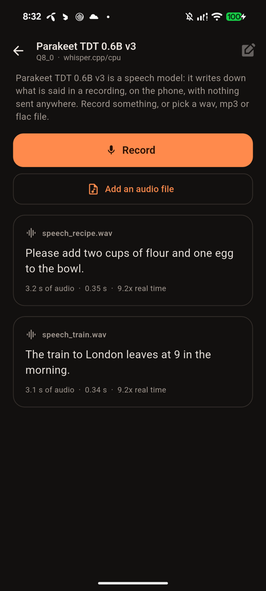
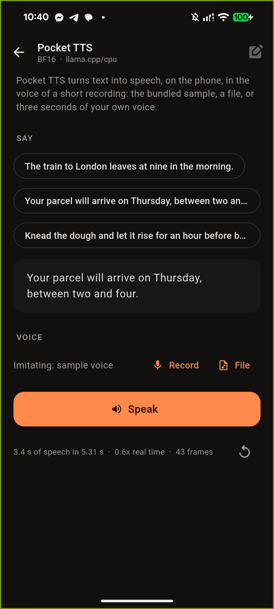
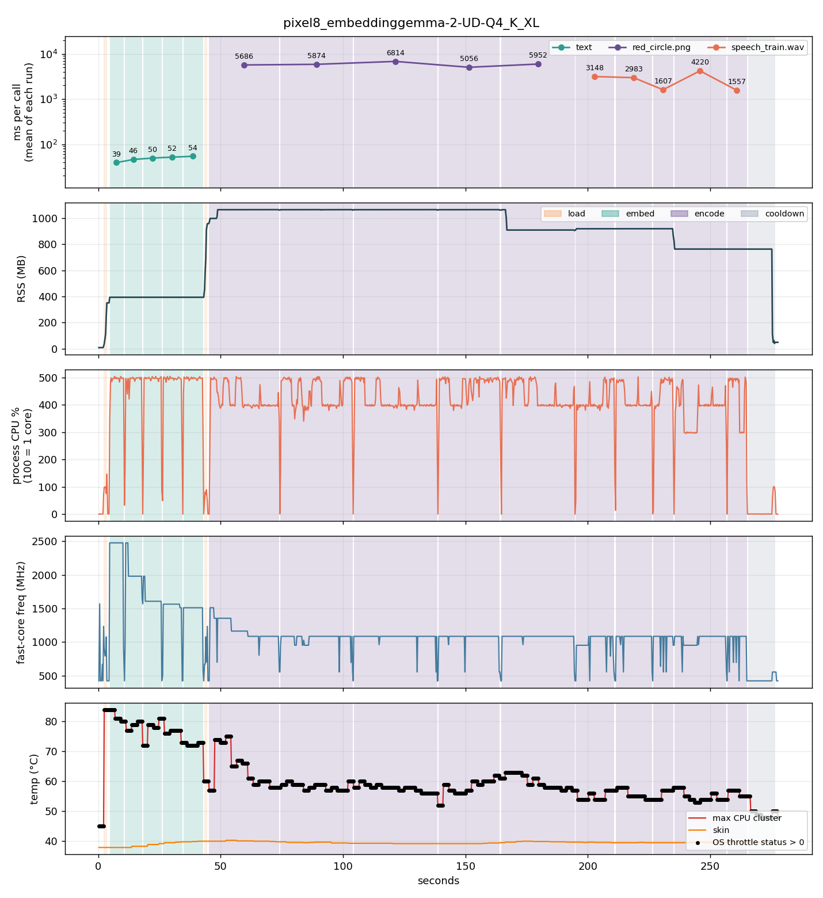

<p align="center">
  
</p>

<p align="center"><b>On-device LLM runtime for Android and desktop, with iOS in progress. Honest about what it runs on.</b></p>

<p align="center">
  
</p>

Every mobile LLM library promises "runs on phones" and backs it with a device list the
maintainers happened to own. kiln is built the other way round:

- **The slow path is the promise.** llama.cpp on CPU with a Q4 model is the guaranteed tier.
  It works on any arm64 device with enough RAM.
- **Acceleration is detected, never assumed.** Metal on Apple silicon today; NPU backends
  later. Enabled only when the probe finds them, never silently.
- **The API tells you what actually happened.** Which backend loaded, how much memory it
  took, real tokens per second for every call, how much of the conversation was reused.

## Status

v0.3.0 added embedding models (text, images and audio); v0.3.1 fixes core selection on chips
with no little cores; v0.4.0 adds speech to text (`kiln_transcribe`) with Whisper, Parakeet
and Qwen3-ASR; v0.5.0 adds text to speech (`kiln_speak`) with Pocket TTS. Run on 2026-10-12 and 2026-10-13 on the phones, the MacBook, the Linux
desktop and a Linux container. The iPhone row is still from
v0.1.0, and the chat benchmarks were not repeated since v0.1.0:

| platform | backend | what passed |
|---|---|---|
| Galaxy S26 Ultra (Snapdragon 8 Elite Gen 5, Android 17), v0.3.1 | llama.cpp CPU, 6 threads pinned | 319 C checks, 26 Flutter integration tests, example app, benchmarks; [profile](docs/devices/galaxy-s26-ultra.md) |
| Pixel 8 (Tensor G3, Android 16), v0.5.0 | llama.cpp CPU, 5 threads pinned; whisper.cpp CPU | 505 C checks, 26 Flutter integration tests (4 skipped); chat, decision and embedding benchmarks at v0.3.0 |
| iPhone 16 Pro (A18 Pro, iOS 26.6), v0.1.0 | llama.cpp Metal | **In progress, not supported yet.** 7 of 9 Flutter integration tests at v0.1.0; not re-run since |
| MacBook Pro M4 Pro, v0.5.0 | llama.cpp Metal; whisper.cpp Metal | 505 C checks (three speech-to-text models, one text-to-speech model); chat benchmarks at v0.1.0 |
| Ryzen 5 8500G desktop (Linux x86_64), v0.5.0 | llama.cpp and whisper.cpp CPU, 8 threads | 505 C checks, with Whisper, Parakeet and Pocket TTS (2026-10-14) |
| Ryzen 5 8500G desktop and MacBook Pro M4 Pro, Rust bindings (`rust/`) | the same, linked statically from Cargo | 11 Rust tests over the same models (chat, decision, embeddings, images, Whisper, Parakeet, Pocket TTS) on both, 2026-10-15; Android, iOS and Windows not tried |
| Ryzen 5 8500G and M4 Pro desktop JVMs, Pixel 8 (Android 17): Kotlin API (`android/`) | the JNI glue, and the `.aar` built with the NDK | 12 Kotlin tests over the same models on both desktops; on the Pixel 8 the device test (load, probe, chat with LFM2.5 350M); 2026-10-15 |
| Linux arm64 (Ubuntu 24.04 in Docker on the M4 Pro), v0.5.0 | llama.cpp CPU, OpenMP; whisper.cpp CPU | 505 C checks (2026-10-13); at v0.4.0 Parakeet took 66 ms and Whisper base 577 ms for the 3-second clip on the CPU; at v0.3.0 also emulated x86_64 (319) and `KILN_CPU_MASK=3` |

Models verified end to end: LFM2.5 350M, Qwen3.5 0.8B (thinking on and off), Gemma 3 270M,
the decision model LFM2 d1-omni 600M, and the embedding models EmbeddingGemma 2 (text, images,
audio), nomic-embed-text v1.5 (text) and jina-embeddings-v5-omni-nano (text, images). All of
them through the C API, and the speech models Parakeet TDT 0.6B v3 and Whisper base (through
whisper.cpp) and Qwen3-ASR 0.6B (through llama.cpp): a 3-second clip in 0.3 s with Parakeet
on the Pixel 8 CPU, 53 ms on the M4 Pro GPU. Chat, `decide`, `embed` / `embedMedia` (EmbeddingGemma 2)
and `transcribe` (Whisper, Parakeet) through the Flutter plugin on the Pixel 8. Text to speech: Pocket TTS
(Kyutai, English) through the C API and the plugin on the Pixel 8, 2.7 s of speech in 3.4 to 4.1 s (0.7 to 0.9x real time; about a second of it is encoding the voice); Qwen3-TTS 1.7B
through the C API on the M4 Pro only.
**iOS is in progress.** It built and ran on an iPhone at v0.1.0, but it has not been re-run for
v0.2.0 and is not part of the pub.dev package. Use Android for now.

Not yet: MediaTek and older or mid-range Snapdragon phones, 4 GB RAM devices, x86 emulators.
`kiln_flutter` 0.3.1 is on pub.dev as an Android-only package. The
[release checklist](docs/RELEASE.md) lists what is still open.

## Quick start

### Flutter

[`kiln_flutter`](https://pub.dev/packages/kiln_flutter) is on pub.dev:

```bash
flutter pub add kiln_flutter
```

Set `minSdk = 29` and run on an arm64 Android phone. **[Getting started](docs/GETTING_STARTED.md)**
walks through every step, from an empty project to a first chat and a first decision.

```dart
final kiln  = await Kiln.create();
final model = await kiln.loadModel('/path/to/model.gguf');
print(model.info);                       // qwen35 Q4_K_M, 0.75B, via llama.cpp/cpu, thinking

final ctx = await model.createContext();
final gen = ctx.chat([KilnChatMessage.user('Why is the sky blue?')], enableThinking: true);
await for (final p in gen.pieces) {
  p.isReasoning ? showThinking(p.text) : showAnswer(p.text);
}
print(await gen.stats);                  // 36.8 tok/s, 21 of 40 prompt tokens cached, [eos]
gen.cancel();                            // from anywhere, any time
```

Package: [flutter/kiln_flutter](flutter/kiln_flutter/README.md). Everything blocking runs on a
background isolate. The example app in `flutter/kiln_flutter/example` is a full chat UI with
a model downloader, thinking toggle, collapsible reasoning and per-reply stats, plus a Decide
screen for decision models and a Search screen for embedding models.

<p>
        
</p>

### Rust

Linux x86_64 only so far; see [rust/README.md](rust/README.md).

```rust
let model = kiln::Model::load("model.gguf", &kiln::ModelParams::default())?;
let mut ctx = model.context(&kiln::ContextParams::default())?;
let history = [kiln::Message::user("Hi")];
ctx.chat(&history, &Default::default(), &Default::default(), |piece| {
    print!("{}", piece.text);            // piece.channel: Answer or Reasoning
    true                                 // false = stop
})?;
```

### Kotlin (Android)

The `.aar` builds and its device test (chat) passes on the Pixel 8; the full model set is tested on the desktop JVM. See [android/README.md](android/README.md).

```kotlin
// every call blocks: run this on a background thread (or use ctx.chatFlow from a coroutine)
KilnModel.load(path).use { model ->
    model.newContext().use { ctx ->
        ctx.chat(listOf(Message.user("Hi"))) { piece -> print(piece.text); true }   // or ctx.chatFlow(...) from a coroutine
    }
}
```

### C

```c
kiln_model*   m; kiln_model_load("model.gguf", NULL, &m);
kiln_context* c; kiln_context_create(m, NULL, &c);

bool on_piece(kiln_channel ch, const char* piece, int32_t tok, void* user) {
    fputs(piece, stdout);                // ch: KILN_CHANNEL_ANSWER or KILN_CHANNEL_REASONING
    return true;                         // false = stop
}

kiln_chat_message history[] = {{"user", "Hi"}};
kiln_gen_stats st;
kiln_chat(c, history, 1, NULL, NULL, on_piece, NULL, &st);   // pass the full history each turn
```

```bash
git clone --recursive https://github.com/RaihanulHaque/kiln && cd kiln
cmake --preset host && cmake --build --preset host -j        # macOS / Linux
./build/host/kiln-cli --probe
./build/host/kiln-cli -m model.gguf --chat                   # interactive, shows cache reuse per turn

cmake --preset android-arm64 && cmake --build --preset android-arm64 -j
scripts/android-run.sh model.gguf -n 64                      # push to a phone over adb and run
scripts/build_ios.sh                                         # xcframework for the Flutter plugin
```

The Android presets and scripts find the NDK under `~/Library/Android/sdk/ndk` (macOS) or
`~/Android/Sdk/ndk` (Linux); set `ANDROID_NDK_HOME` if it lives elsewhere.

Already cloned without `--recursive`? Run `git submodule update --init --recursive` (the CMake
configure step also tries this automatically when `third_party/llama.cpp` is empty).

## What makes it honest

**Threads are pinned to the fast cores.** The probe groups cores by clock, drops the little
cores and binds one ggml worker to each remaining core. On a Pixel 8 that is the difference
between 21 tok/s and 3 tok/s once the phone is warm: unpinned, Android parks workers on the
little cores and every matmul waits for the slowest one. [Sweep](docs/bench/threads/README.md).
On a Galaxy S26 Ultra, whose chip has no little cores, the first rule picked 2 of 8 cores;
measuring that phone changed the rule, and unpinned threads were just as ruinous there
(a prompt read at 3 tokens per second). [What that phone taught](docs/devices/galaxy-s26-ultra.md).

**Templates are the model's own.** The GGUF's jinja template runs through llama.cpp's minja
engine, so system prompts, Gemma's role rules and Qwen's `enable_thinking` switch all behave
as the model authors intended. No per-model code in kiln.

**Reasoning is a channel.** Think tags are stripped and each piece is tagged answer or
reasoning, with `reasoning_tokens` in the stats, so a UI can show a collapsible thinking
block and count tokens truthfully. Small reasoning models often never stop thinking, so
`max_reasoning_tokens` sets a budget: when it is reached kiln closes the think block and the
model answers. `reasoning_truncated` in the stats says when that happened.

**Multi-turn reuses the KV cache.** Pass the whole history; kiln evaluates only the suffix
that changed. Hybrid models (LFM2, Qwen3.5) cannot rewind partial state, so kiln saves a
checkpoint of it at the end of each turn's history and rewinds to that when the template
rewrites the reply that follows. Reported in `cached_tokens`.

**Stats are per call.** Prompt and generation tok/s, cache hits, why it stopped. On a phone
the number falls as the chip heats; kiln lets the app see that instead of hiding it.

**Decision models answer without generating.** A model such as LFM2 d1-omni reads a state and
a typed question (yes / no, pick one, rate on a scale) and returns a probability per option in
one forward pass. `kiln_decide` runs it; `kiln_model_info.is_decision_model` says when to use
it. Text state only for now, and C API only (not yet in the Flutter plugin).

```c
kiln_decision_option teams[] = {{"billing", "Payments and refunds"}, {"shipping", "Delivery problems"}};
kiln_decision_question q = {"team", KILN_QUESTION_CHOICE, "Which team should handle this?", teams, 2};
float probs[2]; kiln_decision_answer a;
kiln_decide(ctx, "My parcel never arrived.", &q, probs, 2, &a);   // teams[a.best], probs[], a.confidence
```

**Embedding models turn text into a vector.** Texts with a similar meaning get similar
vectors, which is what search over the user's own notes or documents needs. `kiln_embed` runs
one; `kiln_model_info.is_embedding_model` says when to use it and `n_embd` how long the vector
is. Tell kiln whether a text is the query or a document and it adds the prefix the model was
trained with:

```c
float q[768], d[768];
kiln_embed_options o = kiln_embed_options_default();
o.kind = KILN_EMBED_QUERY;
kiln_embed(ctx, "how do I reset my password", &o, q, 768, NULL);
o.kind = KILN_EMBED_DOCUMENT;
kiln_embed(ctx, "Steps to recover account access: open Settings, then Security.", &o, d, 768, NULL);
float similarity = 0;                       // vectors have length 1, so the dot product is the cosine
for (int i = 0; i < 768; ++i) similarity += q[i] * d[i];
```

Some embedding models also take images and audio and put them in the same space as text, so
a text query can find a photo or a voice note. They need a second file, the projector:

```c
kiln_model_load_projector(m, "mmproj-embeddinggemma-2-Q8_0.gguf", NULL, NULL);
kiln_media photo = {"holiday.jpg", NULL, 0};          // a path, or the bytes of the file
kiln_embed_media(ctx, NULL, &photo, 1, NULL, d, 768, NULL);
// compare d with the vector of the query "a lake between mountains", as above
```

Storing and searching the vectors is the app's job. C API only for now, measured on a Linux
desktop CPU with EmbeddingGemma 2 at 4 bits: about 15 ms for a short sentence, 0.7 s for a
small image, 0.2 s for a 3-second audio clip, and about 1 GB of memory once the projector is
loaded (0.4 GB without it).

## Measured

Generation tok/s, 5 runs back to back of the same job. "cold" is the first run, "warm" the
last. Pixel 8 figures are from v0.3.0 (2026-10-13), M4 Pro from v0.1.0 on a quiet machine.
Details, charts and raw CSVs in [docs/bench](docs/bench/README.md).

| model | quant | resident | Pixel 8 cold → warm | Galaxy S26 Ultra warm → warmer | M4 Pro Metal |
|---|---|---|---|---|---|
| LFM2.5 350M | Q4_K_M | 0.23 GB | 111 → 98 | 224 → 194 | 210 to 360 |
| Qwen3.5 0.8B | Q4_K_M | 0.52 GB | 37 → 26 | 76 → 56 | 140 to 147 |
| Gemma 3 270M | Q8_0 | 0.29 GB | 80 → 65 | 173 → 146 | 118 to 166 |

The Galaxy S26 Ultra (2026-10-12) started every series already warm, at throttle status 1, so
its first-run figures are not cold numbers. An iPhone 16 Pro ran LFM2.5 at v0.1.0 and was not
benchmarked.

Sustained generation on the Pixel 8 holds the CPU cluster at 80 °C and steps the fast cores
from 2.48 GHz to 1.69 GHz within a minute; token rate follows. Any phone benchmark shorter
than a minute reports the cold number.


### Decision and embedding models

These do not generate text, so tokens per second does not apply. What matters in an app is the
time for one call. `kiln-bench` runs them too: bursts of questions or inputs back to back, with
the same heat and memory sampling as for chat. Every figure is the average call of a burst
(40 questions, 150 notes, or 5 images or clips). "first" is the first burst and "sustained"
the fifth in a row, a minute or more into nonstop work. Neither phone started cold: the
Pixel 8 was at throttle status 1 for the decision and embedding runs, as was the S26 Ultra.
The two Pixel 8 "first" figures for media are the exception, marked with *: those are single
calls on a cool phone, timed with `kiln-cli`, because in the bench the media bursts come after
750 notes and never see a cool phone. Measured 2026-10-12 and 13, v0.3.0.

| what one call does | model | Pixel 8 first | Pixel 8 sustained | S26 Ultra first → sustained | M4 Pro Metal |
|---|---|---|---|---|---|
| answer a question about a short message (79 tokens) | LFM2 d1-omni 600M, Q8_0 | 0.21 s | 0.38 s | 77 → 122 ms | 20 ms |
| embed a note (26 tokens) | EmbeddingGemma 2, UD-Q4_K_XL | 39 ms | 54 ms | 17 → 24 ms | 12 to 17 ms |
| embed a note (24 tokens) | nomic-embed-text v1.5, Q4_K_M | 27 ms | 33 ms | 10 → 13 ms | 6 ms |
| embed a small image (85 tokens, 81 of them from the image) | EmbeddingGemma 2 with its Q8_0 projector | 2.8 s * | 6.0 s | 1.5 → 2.2 s | 95 ms |
| embed a 3-second audio clip (82 tokens, 78 from the clip) | the same | 0.9 s * | 1.6 to 3 s | 0.55 s | 50 ms |

On the phone the sustained numbers are slower for two reasons, and the charts show both. Heat:
within a minute Android steps the fast cores from 2.48 GHz down to about 1.1 GHz to protect
the skin temperature, and holds them there. Memory: with a 1 GB model loaded and other apps
running, Android takes pages of the model back, and a call that needs them rereads them from
storage (single calls of 2 to 6 s). [docs/bench](docs/bench/README.md#embedding-models) has
the detail.

In practice: sorting a message into a few classes feels instant, a search query over notes
that are already embedded takes well under a tenth of a second, and photos and audio are slow
enough that an app should embed them in the background when they are added.



## Repository

```
include/kiln/kiln.h          the C API; bindings are generated from this file only
src/core/                    C API implementation, backend registry, error plumbing
src/probe/                   device probe: SoC, cores, clocks, RAM, ISA features
src/backends/llamacpp/       the guaranteed-tier backend
tools/kiln-cli, kiln-bench   test harness and resource benchmark
tools/barrier-lab            standalone experiment: how ggml's per-op barrier reacts to slow cores
tests/                       C test suite (host and device)
flutter/kiln_flutter/        Flutter plugin, example app, integration test
rust/                        Rust bindings: kiln-sys (generated) and kiln (safe API)
android/                     Kotlin / Android library: JNI glue + Kotlin API, one libkiln_jni.so
scripts/                     model download, adb runners, benchmarks, vendoring, iOS build, brand assets
docs/                        concepts, codebase walkthrough, architecture, glossary, benchmarks
third_party/llama.cpp        pinned submodule: chat, decision, embedding and Qwen3-ASR models
third_party/whisper.cpp      pinned submodule: Whisper and Parakeet, built on llama.cpp's ggml
```

## Tests

```bash
scripts/fetch_models.sh                                      # the six test GGUFs into models/ (~1.7 GB); --media adds 0.9 GB, --speech 1.9 GB (Qwen3-ASR, Whisper base, Parakeet, Pocket TTS)
./build/host/kiln-tests models                               # C suite on the host
scripts/android-test.sh                                      # C suite on a phone over adb
cd flutter/kiln_flutter/example && flutter test integration_test -d <device>
cd rust && cargo test --release                              # Rust bindings, same models
cd android && ./gradlew :kiln:testDebugUnitTest              # Kotlin API on the desktop JVM, same models
```

The C suite needs the six test GGUFs in `models/` (`scripts/fetch_models.sh`); missing ones are skipped. The Flutter
integration test downloads what it needs. Add `--dart-define=KILN_SPEED=true` for a
per-model speed run through the plugin.

## Docs

Start with [CONCEPTS](docs/CONCEPTS.md), then the [codebase walkthrough](docs/CODEBASE.md).
Also: [architecture and roadmap](docs/ARCHITECTURE.md), [CPU notes](docs/CPU.md),
[glossary](docs/GLOSSARY.md), [benchmarks](docs/bench/README.md),
[speech models compared](docs/ASR_COMPARISON.md),
[quantization on phones](docs/QUANT.md),
[release checklist](docs/RELEASE.md).

## License

MIT.
