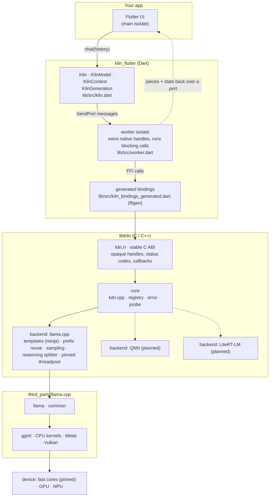
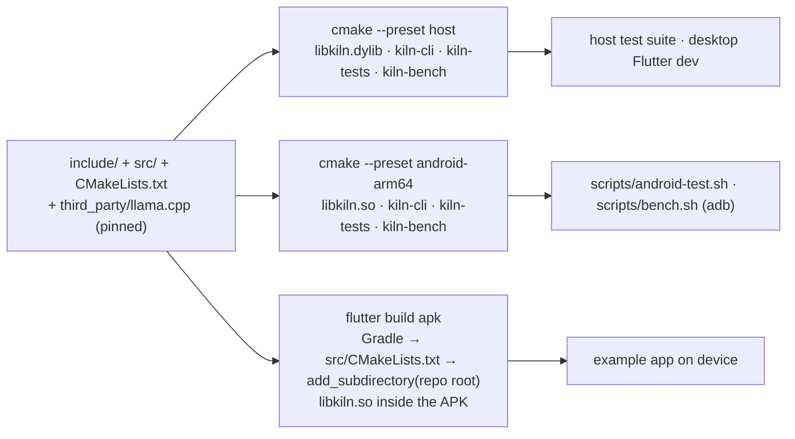

# Architecture

## Layers

Anything above `kiln.h` is generated or thin. Anything below it is C++ that never sees Dart.

## Rules

1. **Nothing but C crosses `kiln.h`.** No exceptions, no std types, no structs with padding
   surprises. Every struct that may grow gets a `_default()` constructor so callers never
   zero-init by hand.
2. **Backends implement `kiln::Backend / Model / Context`** (see `src/core/internal.h`).
   The registry order is the priority order. llama.cpp is always last and always present.
3. **`KILN_BACKEND_AUTO` is conservative.** It picks the GPU only where that is known to be a
   win (Apple silicon). On Android it stays on CPU until a device-specific benchmark says
   otherwise. Explicit `KILN_BACKEND_GPU` is honoured or fails loudly, never silently
   downgraded.
4. **`kiln_model_info` and `kiln_gen_stats` are not optional niceties.** They are the product.
   The Flutter sample app will surface them on screen.
5. **Templates are the model's, executed faithfully.** No per-model special cases in kiln. If a
   template needs a kwarg (`enable_thinking`), it goes through `kiln_chat_options`.
6. **Reasoning is a channel, not a string hack.** `ReasoningSplitter` watches for the template's
   own think tags (from `common_chat_params`) and handles tags split across token pieces.

## Build flow

One source tree, three outputs, no copies.

## Threading

- `kiln_generate` blocks the calling thread. Bindings run it on a worker and marshal pieces
  back to the UI thread.
- `kiln_cancel` is safe from any thread. It flips an atomic that is checked between tokens and
  inside ggml via the abort callback, so a long prompt eval also stops promptly.
- One `kiln_context` is single-consumer. Many contexts may share one `kiln_model`.

## Roadmap

- [x] C core, llama.cpp backend, probe, CLI, host + Android builds
- [x] Clamp reported `n_gpu_layers_used` to real layer count; map `mtl` -> `metal`
- [x] Fast-core detection + pinned ggml threadpool on Android (Pixel 8: 61 -> 108 tok/s)
- [ ] Validate the "highest core index = biggest core" assumption on Snapdragon and MediaTek
- [x] Jinja chat templates via llama.cpp common/minja; `enable_thinking` detected empirically
- [x] Reasoning / answer channels in `kiln_token_cb`, tags stripped, split-across-pieces safe
- [x] `kiln_chat` with KV prefix reuse; recurrent-model fallback; EOG cached so turns chain
- [x] Test suite (host + adb), 127 checks green on M4 Pro and Pixel 8
- [x] v0.1.0: header frozen
- [x] kiln-bench: RSS / CPU / freq / thermal over time, host + device, charts (docs/bench)
- [x] Thread sweep on Pixel 8: 5 pinned wins; unpinned collapses to 3 tok/s warm (docs/bench/threads)
- [ ] Generalised core-set policy: tier grouping with tolerance, no-little layouts (see docs/CPU.md §6)
- [ ] Auto-tune: micro-benchmark candidate core sets on first run, cache per (soc, arch)
- [ ] Validate the "highest core index = biggest core" assumption on Snapdragon and MediaTek
- [ ] GPU utilisation in kiln-bench on Metal
- [x] KV state checkpoints (`llama_state_seq_*`) so hybrid models reuse cache across turns
- [x] Thinking budget: `max_reasoning_tokens` closes the think block; `reasoning_truncated` in stats
- [ ] Sampling defaults for thinking mode: the repeat penalty made the answer loop more often (13 vs 16 of 16 runs)
- [ ] Probe: one thread per physical core (SMT), and rank cores by measured speed or `acpi_cppc/highest_perf` (docs/CPU.md §8)
- [x] v0.2.0: ABI changed (chat options, gen stats, model info); see CHANGELOG.md
- [x] Decision models (LFM2 d1-omni, text state): `kiln_decide`, ported from llama.cpp's server
- [ ] Decision models: images and audio (mtmd + mmproj), other families
- [x] v0.3.0: embedding models (`kiln_embed`): EmbeddingGemma 2, nomic-embed-text v1.5, jina v5 omni nano
- [x] v0.3.0: images and audio for embedding models (`kiln_embed_media`, llama.cpp mtmd): EmbeddingGemma 2 (both), jina v5 omni nano (images)
- [x] Embeddings in the Flutter plugin (`embed`, `embedMedia`, `loadProjector`); macOS (Metal) and Android (Pixel 8) runs
- [ ] Embeddings: iOS run, several inputs per call, video, raw pixels and samples, rerankers
- [x] First Snapdragon run and core selection for chips with no little cores (Galaxy S26 Ultra); OpenCL on Adreno tried, slower than CPU for sub-1B models
- [ ] Images and audio for chat models (the projector plumbing is now in the build; decision models are tracked above)
- [x] v0.4.0: ASR (speech to text): `kiln_transcribe`, a chat-style call that takes an audio clip and streams the words. Qwen3-ASR 0.6B,
      same text as `llama-server`; Linux x86 only so far. (The Whisper and Parakeet files in `mtmd` are encoders that feed a text model,
      not recognisers by themselves, so a plain Whisper or Parakeet GGUF does not work here.)
- [ ] ASR: phone run and speed (Pixel 8), macOS, Flutter `transcribe`, raw microphone samples, cutting long recordings, a 4-bit file
- [ ] TTS (text to speech): `mtmd` has Qwen3-TTS and PocketTTS, but its header marks audio generation as experimental and subject
      to breaking changes. Needs a new output kind in `kiln.h` (audio samples). Check how stable that API is in a newer llama.cpp first. Nothing run yet
- [ ] Voice loop in the example app once both exist: ASR -> chat -> embeddings lookup -> TTS, all offline from GGUF files
- [ ] Tool calling: common already parses it; expose `kiln_tool` + a TOOL_CALL channel
- [ ] Runtime ISA dispatch (i8mm / sve) instead of one baseline build
- [ ] Context-length auto-cap from available RAM in the probe
- [x] Flutter plugin (`kiln_flutter`) via `ffigen`, worker isolate, example chat app verified on Pixel 8
- [x] iOS: xcframework via scripts/build_ios.sh, podspec vendors it; runs on iPhone 16 Pro (Metal)
- [x] Flutter integration test (10 cases) green on Pixel 8; vendoring script for pub.dev
- [ ] iOS: re-run the integration suite after the chat() deadlock fix; simulator slice in CI; SoC name in the iOS probe
- [ ] Example app: throttle setState per piece (UI rebuild costs ~15% tok/s on Pixel 8)
- [ ] Opt-in benchmark upload from the sample app -> real device compatibility table
- [ ] Android GPU, measured before enabled: `-DKILN_ANDROID_GPU=vulkan|opencl` exists but has no numbers. Run `kiln-bench` on the
      Pixel 8 (Vulkan, Mali) with a small and a larger model, and time the image encoder; OpenCL on a Snapdragon (Adreno) phone when one
      is available. Expectation to test, not a result: little gain for token generation (memory-bound), more for prompt eval and encoders
- [ ] Pick CPU or GPU per device from a first-run benchmark, fall back to CPU on a bad driver (part of the auto-tune item above)
- [ ] NPU: look at `ggml-hexagon` in the pinned llama.cpp (Qualcomm). It is the one NPU route that might run plain GGUF files. Not read or tested
- [ ] QNN backend for Snapdragon NPUs, gated on probe + model artifact availability. Vendor NPU SDKs need a converted model per
      chip, which breaks "one GGUF runs everywhere"; not planned unless the Hexagon route fails and a device shows a clear need
- [ ] TFLite / LiteRT as a second backend: not planned. A separate runtime with no shared model contract; revisit only for a model that exists in no other form
- [ ] JNI binding for Kotlin/Java
- [ ] Model manager: download, verify, cache, choose variant per device
