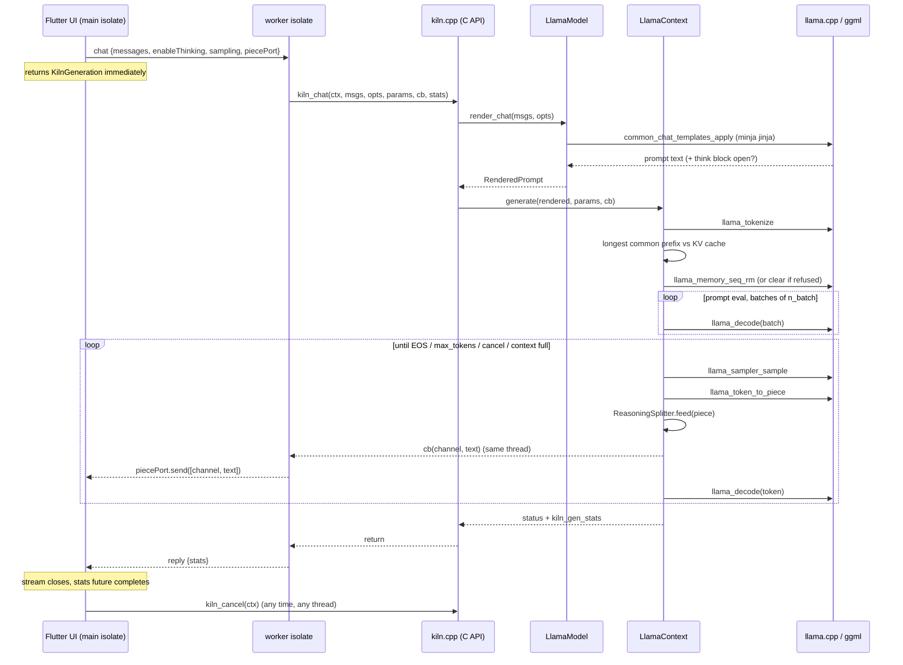
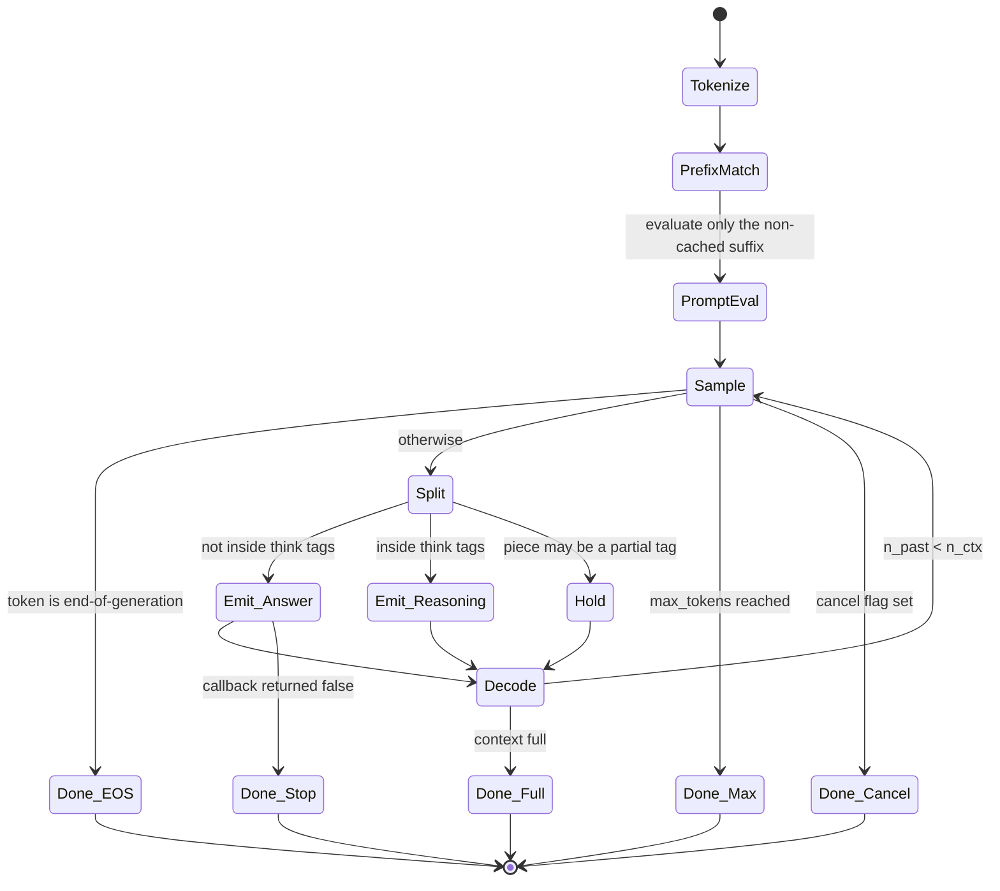

# Codebase walkthrough

What each file does and what happens during one chat call. Pair with
[CONCEPTS.md](CONCEPTS.md) for the ideas and [ARCHITECTURE.md](ARCHITECTURE.md) for the rules.

## Layout

```
include/kiln/kiln.h                 the public C API. The only header bindings see.
src/core/internal.h                 C++ interfaces Backend / Model / Context that backends implement
src/core/kiln.cpp                   C API functions: validate args, pick a backend, forward
src/core/error.cpp                  thread-local last-error string, logging
src/core/registry.cpp               ordered list of backends: llama.cpp, then whisper.cpp; each reads its own file format
src/probe/probe.cpp                 device probe: SoC, cores, clocks -> fast-core mask, RAM, ISA bits
src/backends/llamacpp/
    llamacpp_backend.cpp            the main backend: load, template, generate, threadpool pinning
    reasoning_splitter.h            splits streamed text into answer / reasoning by think tags
    decision.h                      decision models: render the systemone template, one pass, scores -> probabilities
    embedding.h                     embedding models: detect, add the task prefix, one pass, shorten and normalise the vector;
                                    images and audio mixed with text in one batch
    media.h                         the projector (llama.cpp's mtmd): load it, decode image / audio files, AffinityScope;
                                    shared by embedding models and speech models
    transcript_filter.h             speech models: removes the "language English<asr_text>" header from the streamed text
src/backends/whispercpp/
    whispercpp_backend.cpp          Whisper and Parakeet through whisper.cpp's two libraries: sniff the file, load, decode
                                    the audio (its own static miniaudio), stream the segments, timings
tools/kiln-cli/main.cpp             command-line harness; --chat, --think, --think-budget, --ask (decision models), --embed / --query / --mmproj / --media (embedding models), --transcribe (speech models)
tools/kiln-bench/main.cpp           resource sampler + repeated-run benchmark for chat, decision, embedding and speech models
tools/barrier-lab/main.cpp          standalone experiment (not in the CMake build): split work + ggml-style barrier
tests/test_core.cpp                 the C test suite (host and device)
flutter/kiln_flutter/
    src/CMakeLists.txt              Gradle entry: builds the core from src/core (vendored) or the repo root
    ffigen.yaml                     generates lib/src/kiln_bindings_generated.dart from kiln.h
    lib/src/native.dart             loads libkiln for the platform (process() on iOS)
    lib/src/types.dart              Dart mirrors of the C structs, map <-> native
    lib/src/worker.dart             background isolate that owns handles and runs blocking calls
    lib/src/kiln.dart               public API: Kiln, KilnModel, KilnContext, KilnGeneration
    ios/kiln_flutter.podspec        vendors ios/Frameworks/kiln.xcframework with -force_load
    example/lib/main.dart           the demo chat app
    example/integration_test/       on-device test suite (+ KILN_SPEED speed group)
scripts/
    fetch_models.sh                 download the six test GGUFs into models/; --media and --speech add the encoders and the speech model
    android-run.sh, android-test.sh push the CLI / C tests to a phone over adb
    bench.sh, bench_plot.py, bench_compare.py   resource benchmarks and charts
    vendor_flutter.sh               copy the core into the plugin for pub.dev
    build_ios.sh                    static libs + xcframework for iOS
    brand.py, export_brand.py, make_promo.py    logo, assets, promo video
third_party/llama.cpp               git submodule, pinned to a tag
third_party/whisper.cpp             git submodule, pinned; built without its own ggml, against llama.cpp's
```

## The three objects

- **Model** (`kiln_model`): the weights, tokenizer, chat template, and the device decision
  (backend, thread count, pin mask). Created by `kiln_model_load`. Expensive. Share it.
- **Context** (`kiln_context`): one conversation's KV cache plus a pinned ggml threadpool.
  Created from a model. Cheap-ish. One per chat; a context runs one generation at a time.
- **Generation**: not an object in C (a blocking call), but in Dart it is `KilnGeneration`:
  a stream of pieces, a future of stats, and `cancel()`.

## One `kiln_chat` call, top to bottom



1. **Dart** `KilnContext.chat(history)` sends a message to the worker isolate with the
   message list, options, sampling params, and a port for pieces. Returns immediately with a
   `KilnGeneration` wrapping that port's stream.
2. **Worker isolate** (`worker.dart`) marshals the messages into C structs, creates a
   `NativeCallable.isolateLocal` for the token callback, and calls `kiln_chat`. The isolate
   is now blocked inside C until generation ends.
3. **C API** (`kiln.cpp`) validates handles and asks the model to **render** the chat:
   `Model::render_chat` in the backend.
4. **Template** (`llamacpp_backend.cpp`, `render_chat`): builds a `common_chat_templates_inputs`
   with the messages and `enable_thinking`, runs the model's jinja template through
   llama.cpp's minja. Output: the prompt string, plus whether the prompt already opened a
   think block (so the splitter starts in reasoning mode).
5. **Prefix reuse** (`LlamaContext::generate`): tokenizes the prompt, compares with the token
   list currently in the KV cache, keeps the common prefix. Tries `llama_memory_seq_rm` to drop
   the rest. If the model refuses (recurrent state), restores the newest checkpoint inside
   the common prefix, or clears everything and starts from zero if there is none.
6. **Prompt eval**: decodes the non-cached tokens in batches of `n_batch` on the pinned
   threadpool. Hybrid / recurrent models end one batch exactly where the history stops
   (`RenderedPrompt::stable_prefix`) and save a checkpoint of their recurrent state there
   (`llama_state_seq_get_data_ext`, `PARTIAL_ONLY`); the last two are kept. The abort callback checks the cancel flag between graph nodes.
7. **Sampling loop**: sample a token (penalties, top-k, top-p, min-p, temperature, or greedy),
   stop on end-of-generation, otherwise turn the token into text and feed it to the
   `ReasoningSplitter`, which emits answer/reasoning pieces to the callback, holding back any
   partial think tag until it can decide. Decode the token into the KV cache and repeat.
   With a thinking budget (`max_reasoning_tokens`), once that many reasoning tokens have been
   produced the loop decodes the end tag (`\n</think>\n\n`) into the context itself, feeds it
   to the splitter, sets `reasoning_truncated`, and carries on: the model now writes the answer.
8. **Callback** fires on the worker isolate's thread; it posts `[channel, text]` to the Dart
   port. Returning `false` from the callback stops generation.
9. **End**: the EOG token is decoded too (so next turn's history is a pure prefix), stats are
   filled, the sampler is freed, `kiln_chat` returns. The worker sends the stats back; Dart
   completes the future and closes the stream.

`kiln_cancel` can be called from any thread at any point in 6 or 7; it flips an atomic that
both the abort callback and the loop check.

## One `kiln_decide` call

A decision model shares none of the loop above: there is no sampling and no KV reuse.

1. **C API** (`kiln.cpp`) validates the question and forwards to `Context::decide`.
2. **`DecisionHead::decide`** (`decision.h`) builds the option list (noul is always
   `[false, true]`; score levels are numbered from 0), then renders the model's `systemone`
   template with the state, question and options. The template marks its pieces with
   `<<d1omni:...>>` separators.
3. The pieces are tokenized one by one: the question and each option are cut to a token budget,
   the state gets whatever room is left. Each option ends in the vocab's mask token.
4. **One `llama_decode`** over the whole prompt. The context was created in embeddings mode
   with `n_batch = n_ubatch = n_ctx`, because the model is not causal and must see the prompt
   in a single batch (`DecisionHead::configure`).
5. The score of option *i* is read from `llama_get_embeddings_ith` at its mask token, in the
   column for the question type (choice, score, noul). A softmax with the calibration
   temperature from the GGUF metadata turns scores into probabilities.

`kiln_chat` on a decision model, and `kiln_decide` on a chat model, return
`KILN_ERR_NOT_SUPPORTED`.

## One `kiln_embed` call

An embedding model also skips the generation loop. It has no sampling, no KV reuse and no
template.

1. **Load.** `EmbeddingHead::init` (`embedding.h`) reads `<arch>.pooling_type` from the GGUF.
   Mean, cls or last means "embedding model"; chat models have none. It also picks the task
   prefixes by architecture (`gemma-embedding*`, `nomic-bert*`); unknown families get none.
2. **Context.** `EmbeddingHead::configure` turns on embeddings output and sets
   `n_batch = n_ubatch = n_ctx`. These models are not causal: every token looks at every
   other one, so a text cannot be fed in pieces. `n_ctx` is therefore the longest text
   accepted (default 2048, never above the model's training context).
3. **C API** (`kiln.cpp`) fills in default options and forwards to `Context::embed`.
4. **`EmbeddingHead::embed`** puts the prefix in front of the text (`task: search result |
   query: ` for an EmbeddingGemma query), tokenizes, and returns `KILN_ERR_CONTEXT_FULL` if
   it does not fit. Then it clears the memory, decodes the whole text in one batch with every
   token marked as an output, and reads the pooled vector with `llama_get_embeddings_seq`.
5. **Shorten and normalise.** With `dimensions = 256` only the first 256 numbers are kept.
   Unless `normalize` is switched off, the result is divided by its length so that a dot
   product of two vectors is their cosine similarity. With `normalize = false` the vector keeps
   the model's own length and a dot product is no longer a cosine.

**With images or audio** (`kiln_embed_media`) step 4 changes. The projector is a second
model file holding an image encoder, an audio encoder, or both. llama.cpp's `mtmd` library
(`third_party/llama.cpp/tools/mtmd`, linked into libkiln) runs it:

1. `kiln_model_load_projector` creates the `mtmd_context` once per model.
2. Each file is decoded (stb_image for pictures, miniaudio for sound) into pixels or samples.
3. `mtmd_tokenize` splits the input at each `<__media__>` marker into chunks: runs of text
   tokens, and one chunk per media item, wrapped in the model's own begin / end tokens.
4. `mtmd_encode_chunk` runs the encoder on a media chunk. Out come vectors of the same size
   the model uses for a text token. How many vectors depends on the input: 81 of them for a
   small image, 25 for each second of audio (EmbeddingGemma 2). Each one takes a place in the
   context, like a token.
5. Everything goes into one `llama_batch_ext` that mixes token ids and those vectors, and
   one `llama_process` call. This follows `add_prompt_mixed` in llama.cpp's server, which is
   how the server handles a non-causal model. Pooling and normalising are the same as for text.

`kiln_chat` on an embedding model, and `kiln_embed` on any other model, return
`KILN_ERR_NOT_SUPPORTED`. To check a change, compare with llama.cpp's own tool built from the
submodule: `llama-embedding -m model.gguf -p "text" --embd-output-format json --embd-normalize 2`
gives the same numbers as `kiln-cli --embed "text"`. For images and audio, start
`llama-server -m model.gguf --mmproj projector.gguf --embeddings -c 2048 -b 2048 -ub 2048`,
read `media_marker` from `/props`, and POST `{"content": {"prompt_string": "<marker>",
"multimodal_data": ["<base64 of the file>"]}}` to `/embedding`.

## One `kiln_transcribe` call

Two paths, chosen by the model that was loaded.

**Whisper or Parakeet** (`whispercpp_backend.cpp`): `kiln_model_load` reads the first twelve
bytes of the file: ggml's old magic says "whisper.cpp format", and the vocabulary size tells
Whisper (51864 to 51866) from Parakeet (1024 or 8192). `SpeechContext::transcribe` decodes
the file to 16 kHz samples, then calls `whisper_full` or `parakeet_full` with greedy sampling
and a segment callback that hands each finished sentence to the caller; `kiln_cancel` and a
callback that returns false both end the run through the engine's abort callback. The stats
come from the engine's own timings. The model's one working state is shared by all contexts
under a mutex.

**Qwen3-ASR** (`llamacpp_backend.cpp`): a chat model with an audio encoder in front. So this
call is `kiln_chat` with the question written by kiln and an audio clip attached.

1. **Load.** `kiln_model_load` for the text model, then `kiln_model_load_projector` for the
   encoder (`MediaProjector::load` in `media.h`). Nothing in the GGUF marks a speech model:
   it is a chat-style model whose projector takes audio.
2. **The instruction.** `LlamaModel::render_transcribe` builds one user message,
   `Transcribe audio to text<__media__>`, and renders it with the model's own chat template.
   The words come from llama.cpp (`common_chat_get_asr_prompt`), the same ones its server
   uses. A language hint adds ` (language: English)`.
3. **The audio.** `LlamaContext::transcribe` decodes the file to samples (miniaudio, 16 kHz).
   `mtmd_tokenize` cuts the prompt at the marker into three chunks: text, audio, text. If the
   total does not fit in the context the call returns `KILN_ERR_CONTEXT_FULL` here.
4. **Encode.** `mtmd_encode_chunk` turns the samples into vectors, 13 per started second of
   sound for Qwen3-ASR (52 for a 3.1-second clip). Audio longer than 8 seconds is cut into 8-second
   windows by `mtmd` and encoded window by window. This step runs under `AffinityScope`.
5. **Read.** The text chunks and the audio vectors are decoded into a cleared context, in
   order (`mtmd_helper_eval_chunk_single`, `mtmd_helper_decode_image_chunk`).
6. **Write.** The same loop as chat (`LlamaContext::sample_loop`), always taking the most
   likely token, with no repeat penalty.
7. **Clean up the text.** Qwen3-ASR writes `language English<asr_text>The train leaves at
   nine.` `TranscriptFilter` holds the first pieces back until it has seen the header, keeps
   the language for the stats and passes on only the words.
8. **Reset.** The context is cleared again, so the audio is not part of any later chat.

To check a change, start `llama-server -m model.gguf --mmproj projector.gguf -t <threads>`
from the submodule and send the file:
`curl localhost:8080/v1/audio/transcriptions -F file=@clip.wav -F temperature=0`. The text
after `<asr_text>` should be what `kiln-cli --transcribe clip.wav -t <threads>` prints. Use
the same thread count on both sides: with a different one, near-equal spellings can swap.
`llama-mtmd-cli` is not the reference: it puts the audio before the instruction, the server
puts it after.

## The generation loop as a state machine



## Two Dart pitfalls that bit us

- `StreamController.close()` returns a future that completes only after a listener has
  drained the stream. Awaiting it in `KilnContext.chat`'s cleanup deadlocked any caller who
  ignored `pieces` and awaited `stats` alone; on Android that surfaced as an ANR. Never await
  that close.
- Mirroring a failure onto the pieces stream must happen *before* the controller is closed,
  so the error handler sits before `whenComplete` in the chain and checks `isClosed`.

## Threading model in one paragraph

Everything blocking runs on the worker isolate (Dart) or on whatever thread calls the C API.
Inside the C call, ggml's threadpool does the math on N pinned workers. The only cross-thread
interaction the library allows is `kiln_cancel`. Pieces are delivered synchronously on the
calling thread; the Dart layer turns that into an async stream.

## Where to change things

| want to | touch |
|---|---|
| add an API call | `kiln.h`, `kiln.cpp`, then the backend; re-run ffigen; add to `kiln.dart` |
| change thread/pin policy | `probe.cpp` (which cores are "fast") and `create_context` in the backend |
| support a new engine | implement `Backend/Model/Context` from `internal.h` (`whispercpp_backend.cpp` is the small example), register in `registry.cpp` |
| change how thinking is detected | `LlamaModel` constructor (empirical on/off render) |
| change the thinking budget behaviour | the end of the sampling loop, `LlamaContext::sample_loop` |
| support a speech model that writes another header | `transcript_filter.h`, and a case in `test_transcript_filter` with the pieces it writes |
| change cache checkpoints for hybrid models | `save_checkpoint` / `restore_checkpoint` in `LlamaContext`; `stable_prefix` in `render_chat` |
| add the task prefix of another embedding model | `EmbeddingHead::init` in `embedding.h`; take the strings from the model card and add it to `test_embedding` |
| support another decision model family | `decision.h`; port its path from llama.cpp `tools/server/server-decision.cpp` and compare with `llama-server` |
| change sampling defaults | `kiln_sampling_params_default` in `kiln.cpp` |
| change the example app | `flutter/kiln_flutter/example/lib/main.dart` |

## Build matrix

| preset | output | used by |
|---|---|---|
| `host` | `build/host/libkiln.dylib` (`.so` on Linux), `kiln-cli`, `kiln-tests`, `kiln-bench` | dev loop, host tests, desktop Flutter |
| `android-arm64` | `build/android-arm64/libkiln.so` + the same tools | adb scripts, benchmarks |
| Gradle via plugin | `libkiln.so` inside the APK | the Flutter app on Android |
| `scripts/build_ios.sh` | `kiln.xcframework` (static, Metal) | the Flutter app on iOS via CocoaPods |

The three builds compile the same sources; the Gradle path just points CMake at the repo
root. ISA baseline for Android is `armv8.2-a+dotprod+fp16`.
