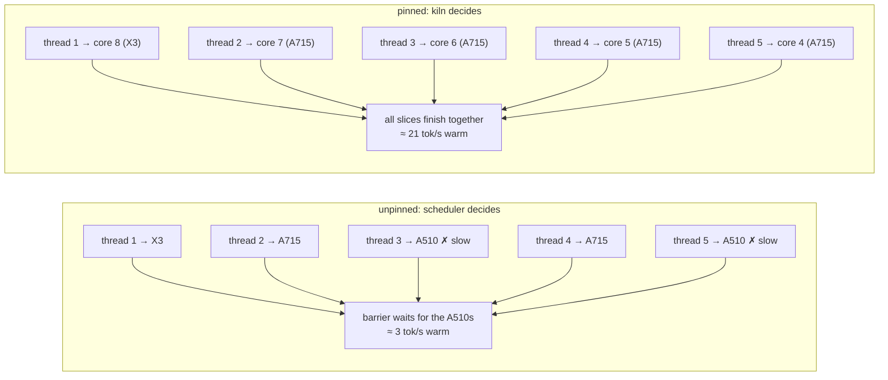
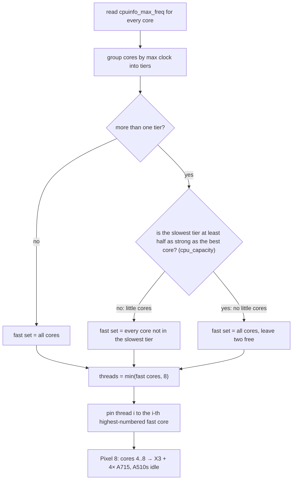

# Concepts, in plain language

Read this before the glossary. It explains the ideas; the glossary defines the terms.

## Cores and threads

A **core** is a physical processor on the chip. The Pixel 8 has nine: one Cortex-X3 (fastest),
four A715 (fast), four A510 (slow, power-saving). That count never changes.

A **thread** is a unit of work that the program creates. kiln asks the math library (ggml) to
split every matrix multiplication into N slices and run them at the same time; N is the
thread count. Five threads on five cores means each core runs one slice and the work finishes
about five times sooner. Five threads on one core means the OS takes turns between them and
nothing gets faster.

So a thread count is a *request*. Which cores run those threads is the operating system's
choice, unless the program pins them.

## Pinned and unpinned

**Unpinned**: the program creates threads and lets Android decide where they run. Android's
scheduler is tuned for battery life, so it will move a thread onto a slow A510 whenever it
thinks that saves power. It also moves threads around while they are running.

**Pinned**: the program sets a CPU affinity mask on each thread: "this thread may run on core
8 only", "this one on core 7 only", and so on. The OS honours it and never migrates them.

Why it matters: ggml runs the N slices and then waits at a **barrier** for all N to finish
before the next step. The step takes as long as the *slowest* slice. One slice on an A510
makes four fast cores sit idle. On a warm Pixel 8 that difference measured 21 tok/s pinned
versus 3 tok/s unpinned, same code, same model.

kiln pins by default. The core set comes from the probe (see below) and can be overridden
with `KILN_CPU_MASK` for experiments or disabled with `KILN_NO_AFFINITY=1`.

## The probe

Before loading anything, kiln reads what the device is: SoC name, how many cores, each
core's maximum clock, RAM, which ARM instruction extensions exist, whether a GPU backend is
compiled in. From the per-core clocks it groups cores into **tiers** and drops the slowest
tier, unless that tier is not made of little cores at all; what remains are the **fast
cores**, which become the thread count and the pin set.
Everything in `kiln_device_info` comes from here and is also what the stats and the sample
app display.

This is the v0.1 policy. [CPU.md §6](CPU.md) lists the SoC layouts where it is wrong and
the auto-tune that should replace it.

## Why generation speed is about memory, not compute

To produce one token the model reads **every weight once**. A 0.8B model at 4-bit is about
0.5 GB. At 40 tok/s that is 20 GB/s of reading, which is near what a phone's RAM can deliver
to the CPU. More cores help only until the memory bus is saturated. This is why 4-bit models
are nearly twice as fast as 8-bit ones of the same size, and why adding threads has
diminishing returns.

## Heat

A phone has no fan. Within a second of sustained generation the CPU cluster reaches its
limit (about 80 °C on a Pixel 8) and the chip lowers its clock to stay there: 2.5 GHz at the
start, 1.7 GHz a minute later. Token rate falls with the clock, roughly 40 to 50% over a
minute. Separately, when the phone's *skin* gets warm (39 °C), Android starts system-wide
throttling in steps.

The consequence: a speed number from a five-second test is the cold number. A chat session
runs at the hot number. kiln reports tok/s per call so an app can see this happen; the
benchmarks report both.

## What a sweep is

Run the identical benchmark job once per setting of one knob, keep everything else fixed,
compare. The thread sweep changed only the thread count and placement (1 to 5, pinned to
the top cores, pinned to the A715s only, unpinned). "Run 1 → 5" inside each configuration
is the same prompt repeated back to back, so that heat is the only thing changing between
run 1 and run 5. See [bench/README.md](bench/README.md).

## The KV cache and multi-turn chat

While reading a prompt the model computes, per layer, a "key" and "value" vector for every
token and stores them: the **KV cache**. Producing the next token then only needs the new
token's math plus a lookup into that cache. It is why the second token is as cheap as the
hundredth.

For a chat, every turn's prompt is the whole history plus the new message. kiln compares the
new prompt's tokens with what the cache already holds and evaluates only the part that
changed, usually just the new user message. That is `cached_tokens` in the stats. Some model
families (LFM2, Qwen3.5, Mamba) keep recurrent state that cannot be partially rewound. For
those, kiln saves a copy of that state (a checkpoint) at the end of each turn's history,
just before the assistant's reply. Templates often rewrite the previous reply on the next turn
(Qwen3.5 drops its think block), so the next turn rewinds to the checkpoint and re-reads only
the last reply and the new message. Without a usable checkpoint it re-reads the whole prompt:
slower, still correct.

A second checkpoint sits right after the system prompt. Many apps are not conversations at all:
an extractor or a classifier sends the same long instructions as the system prompt with a new
text each time, and the end-of-history checkpoint never matches the next request. Example: the
Hishab extractor (Qwen3.5 0.8B) sends 167 prompt tokens, 146 of them the same instructions every
time. With only the end-of-history checkpoint the Pixel 8 re-read all 167 (2.9 s); with the
system-prompt checkpoint it keeps the 146 and reads 21 (0.8 s). To find where the system prompt
ends, kiln renders the template a second time with a dummy user message and keeps what the two
renders share. kiln keeps at most three checkpoints: the system prompt, the latest turn, and one
turn back.

## Cancelling a call

Every kiln call blocks until it is done, so it runs on a background thread, and the app stops it
from another thread with `kiln_cancel(ctx)` (`gen.cancel()` in Flutter, `ctx.cancel()` in Kotlin
and React Native, a `CancelHandle` in Rust). The running call then returns `KILN_ERR_CANCELLED`.

Example: the user taps Send, the model starts a long answer, and the user taps Stop. The UI
thread calls `kiln_cancel`; the chat stops at its next step, whether it is still reading the
prompt or already writing.

Two rules make this safe:

- **A cancel counts from the first moment of the call.** Every call numbers itself before it
  does anything, even before the chat template is rendered, and a cancel marks the call that is
  running. A Stop tapped right after Send therefore stops that call. (Up to 0.5.0, kiln cleared the
  flag when its work began, and a cancel that came during rendering was lost.)
- **A cancel with no call running does nothing.** If the user taps Stop just after the answer
  finished, that tap must not kill the next message. kiln drops it.

Flutter and React Native add a step of their own: they hand the call to a worker, so a cancel
can arrive before kiln has started the call at all. Each of them remembers the cancel for that
call and either never starts it or stops it at the first piece.

## Reasoning models and channels

Models like Qwen3.5 can "think" before answering: they emit a block between `<think>` and
`</think>`, then the answer. The template decides whether thinking is on. kiln strips the
tags and delivers each piece of text on one of two channels, reasoning or answer, so an app
can show a collapsible thinking box and count the tokens separately. With thinking off,
kiln renders the template in a way that tells the model to answer directly.

Small reasoning models often do not know when to stop. Qwen3.5 0.8B reaches a good answer
early in its thinking, then keeps second-guessing it and never writes `</think>`: without a
limit it finished 1 of 20 test runs within 1500 tokens. So `kiln_chat` takes a thinking
budget, `max_reasoning_tokens`. When the reasoning channel reaches it, kiln feeds the end tag
into the model as if the model had written it, and generation continues as the answer. With a
256-token budget the same model finished 43 of 48 runs, and all 16 with the repeat penalty
off. The stats report `reasoning_truncated` so a UI can say the thinking was cut short.

## Decision models

Most models here write text one token at a time. A decision model does not write at all. You
give it a state (some text) and a typed question, and it scores every option in a single
forward pass:

- **noul**: yes or no. "Is the customer asking for a refund?"
- **choice**: pick one of the options you list. "Which team should handle this?"
- **score**: rate on a scale of 2 to 10 levels. "How urgent is this?"

The model's own `systemone` template lays out the state, the question and the options. Each
option ends in a mask token, and the model's output at that token is the option's score. kiln
turns the scores into probabilities with the calibration temperature stored in the GGUF. There
is no sampling, so the same question always gives the same numbers, and an answer costs one
prompt-sized pass: about 150 ms for a 74-token question on a desktop CPU with d1-omni 600M Q8.

`kiln_decide` is a port of the lfm2-d1-omni path of llama.cpp's server (`/v1/systemone`), which
is the only place llama.cpp implements it; asked one question at a time, both give the same
probabilities to six decimal places. Other decision families, images and audio are not ported.
A decision model cannot chat: `kiln_chat` returns `KILN_ERR_NOT_SUPPORTED` on it, and
`kiln_decide` returns the same on a chat model.

## Embedding models

An embedding model does not write text either. It reads a text and returns a list of numbers,
called a vector: 768 numbers for the two models tested here. The numbers mean nothing one by
one. What matters is that two texts with a similar meaning get similar vectors.

Example: a notes app stores one vector per note. The user searches "how do I reset my
password". The app turns that sentence into a vector and compares it with the stored ones:

| note | similarity to the query |
|---|---|
| Steps to recover account access: open Settings, choose Security, ... | 0.738 |
| Passwords should contain at least twelve characters including a symbol. | 0.693 |
| Soda loaf uses baking soda and buttermilk. | 0.546 |

The first note wins although it shares no word with the query. The second shares the word
"password" but does not answer the question, and scores lower. (Numbers from EmbeddingGemma 2
at 4 bits through `kiln-cli --query ... --embed ...`.)

**Similarity** is the dot product: multiply the two vectors number by number and add up.
kiln returns vectors of length 1 by default, so the result is between -1 and 1. This is the
cosine similarity: 1 means the two vectors point the same way, which the model produces for
texts it reads as meaning the same. (With `normalize = false` the vectors keep the model's own
length, and you have to divide by both lengths yourself to get a cosine.)

**Pooling.** The model produces one vector per token. To get one vector for the whole text
they are combined, usually by averaging. The model file says which way; llama.cpp does it.

**Prefixes.** These models are trained with a short label in front of each text that says
what the text is for. EmbeddingGemma expects `task: search result | query: ` before a query
and `title: none | text: ` before a document; nomic expects `search_query: ` and
`search_document: `. Leave them out and the vectors still come out, but search gets worse and
nothing tells you. So `kiln_embed` takes a `kind` (query or document) and adds the right one.
A query and the documents it is compared with must come from the same model.

**Shorter vectors.** EmbeddingGemma is trained so that the first 512, 256 or 128 numbers
still work as a vector by themselves (called Matryoshka, after the nested dolls). 256 numbers
take a third of the storage. On the 16-question test here, 512 numbers gave the same 15 right
answers as 768, 256 gave 14 and 128 gave 13.

**Long texts cost more than their length.** Every token looks at every other token, so a text
twice as long takes more than twice the time. On the desktop CPU EmbeddingGemma 2 took 15 ms
for a 20-token sentence and 1.7 s for 1400 tokens. Split documents into pieces of a few
hundred tokens and store one vector per piece. A text longer than the context is refused with
`KILN_ERR_CONTEXT_FULL`, not cut.

**4 bits is enough for this model.** The 176 MB `UD-Q4_K_XL` file picked the same answers as
the 558 MB full-precision file on that test, and its vectors point almost the same way
(cosine 0.994 on average). The test is small; it shows the small file is not broken, not that
it is equal on every task.

**Images and audio.** Some embedding models put pictures and sound into the same space as
text. "Same space" means the vector of a photo of a lake lands near the vector of the
sentence "a lake between mountains", so a typed query can find a photo, a screenshot or a
voice note. Example, EmbeddingGemma 2, ten files (six images, four audio clips), top results:

| typed query | best match | score | runner-up |
|---|---|---|---|
| a lake between mountains | the fjord photo | 0.722 | 0.587 |
| newspaper front page about the moon landing | the newspaper photo | 0.799 | 0.728 |
| an invoice showing the total amount to pay | the invoice image | 0.720 | 0.600 |
| when does the train to London leave | the spoken clip about the train | 0.835 | 0.565 |

How it works: the model itself only understands token vectors. A second file, the
**projector** (named `mmproj-...gguf`), holds an encoder that turns an image or a sound into
a row of such vectors, as if it were a run of words. They are fed in next to the text and
pooled the same way. With EmbeddingGemma 2 a small image becomes 81 vectors and each second
of audio 25.

What it costs, on the desktop CPU with EmbeddingGemma 2:

| | time | of which encoder |
|---|---|---|
| a short sentence | 15 ms | none |
| a 448 x 448 image | 0.7 s | 0.6 s |
| a 3-second audio clip | 0.2 s | 0.1 s |
| a 17-second audio clip | 1.2 s | 0.7 s |

Memory goes from 0.4 GB to about 1.0 GB when the projector is loaded, because the projector
(555 MB) is larger than the 4-bit text model (176 MB). Load it only if the app needs media.

**Big photos are the trap.** The encoder cuts an image into patches, and a bigger image makes
more of them. A 2000-pixel screenshot became 1080 vectors and took 21.7 s; limited to 280 it
took 3.2 s, and to 70 it took 0.7 s, and it was still the top result for its query each time.
kiln limits an image to 280 by default (`kiln_projector_params.image_max_tokens`).

Models differ in what they take. Of the three tested: nomic-embed-text is text only;
jina-embeddings-v5-omni-nano takes text and images with its small vision projector (203 MB;
its audio projector is 1.3 GB and was not tried); EmbeddingGemma 2 takes text, images and
audio with one projector. Vectors from different models cannot be compared with each other.

kiln stores nothing: it returns the vector and the app keeps it. This was run on Linux x86,
on a Mac (Metal) and on a Pixel 8, and from Flutter on the Pixel 8.

## Speech models

A speech model writes down what someone says. The usual name is ASR, automatic speech
recognition. Example: the app records "The train to London leaves at nine in the morning" and
gets that sentence back as text, which it can then show, search, or hand to a chat model.

kiln runs two kinds of speech model.

**Whisper and Parakeet** are complete speech models: an encoder that turns the sound into
vectors and a decoder of their own that turns the vectors into words. llama.cpp cannot run
such a decoder, so these go through a second engine, whisper.cpp, which is built on the same
maths library (ggml). Their files are one `.bin` each, the encoder included, and
`kiln_model_load` takes them like a GGUF. Parakeet (NVIDIA, 600 million weights) made the
fewest mistakes of the small English models in our comparison and is the fastest; Whisper
(OpenAI) comes in sizes from 39 million weights up, knows 99 languages, and always works on
30-second windows, so a 3-second clip costs about as much as a 30-second one.

**Qwen3-ASR** is built from two parts that were already here. The **audio encoder** (the
projector file) turns the sound into a row of vectors, 13 for each started second. The
**text model** reads those vectors as if they were words, and then writes the sentence one
token at a time, exactly as a chat model writes an answer. So a transcription is a chat turn
where the question is fixed ("Transcribe audio to text") and an audio clip is attached to it.

For Qwen3-ASR the cost has three parts. For the 3-second clip above on the desktop CPU:

| step | what happens | time |
|---|---|---|
| encode | the sound becomes 52 vectors | 0.14 s |
| read | the model takes in the instruction and the vectors (67 tokens) | 0.18 s |
| write | the model writes 14 tokens | 0.35 s |

Writing is the largest part, and it grows with how much was said, not with how long the clip
is. A 17-second clip with 88 tokens of text took 3.3 s, of which 2.1 s was writing.

The number to watch is **how many times faster than real time** it runs. 17 seconds of sound
in 3.3 s is about 5 times faster. Below 1 the app falls behind the speaker. On a Pixel 8 the
3-second clip takes 0.3 s with Parakeet, 3.0 s with Whisper base, and 3.8 s with
Qwen3-ASR, whose encoder alone takes 2.5 s there: on that phone Qwen3-ASR falls behind the
speaker and the other two do not.

Three things to know:

- **They always take the most likely word.** The same clip gives the same text every time on
  the same machine. Across machines, or with a different number of threads, a capital letter
  can differ ("Men Walk on Moon" or "Men walk on moon"); the words stay.
- **Silence gives an empty text** with Parakeet and Qwen3-ASR (a 2-second tone came back as
  nothing). Whisper is known to invent words on sound with no speech in it.
- **Length.** Whisper takes any length (30-second windows). Parakeet takes the clip whole.
  A Qwen3-ASR clip has to fit in the context: at 13 tokens a second the default context holds
  a few minutes, a longer recording is refused, and the app cuts it into pieces.

Memory: Whisper base 60 MB on disk, Parakeet 669 MB, Qwen3-ASR 1.5 GB while it works (the text
model is 805 MB, the encoder 214 MB). kiln takes a file or the bytes of a file, so an app
records to a wav first; the example app does exactly that.

## Text to speech

The other direction: text in, a voice out. A text-to-speech model like Pocket TTS is again a
small text model plus a second file. The text model reads the sentence and, frame by frame
(80 ms each), produces a hidden state; the second file turns each state into a few numbers
that describe the sound (the "codes"), and then into the samples themselves. kiln hands the
samples to the app about once a second, so the first second can be playing while the rest is
still being made.

The voice comes from a short recording. The model listens to about three seconds of someone
speaking and imitates that voice for the sentence; Pocket TTS produces almost nothing without
one. The example app bundles a sample voice and lets you record your own.

What the numbers look like for "The train to London leaves at nine in the morning." (2.7 s of
speech): on a Pixel 8 3.4 to 4.1 s, on the M4 Pro 0.22 s. On the phone that is 0.7 to 0.9x real
time, a little slower than the speaker; about a second of it is encoding the voice recording,
the rest is the frames. Above 1x real time a sentence can be played as it is produced without
stalling; below it, as on the Pixel 8, an app lets a piece or two arrive first.

How kiln checks that the audio is right: it writes it down again with Parakeet and compares
the words. That round trip is in the test suite.

## Chat templates

Each model was trained on conversations formatted a specific way: special tokens around
roles, a fixed system prompt position, rules like "roles must alternate". The format lives
inside the GGUF as a jinja template. Get it slightly wrong and the model still produces
text, just worse. kiln executes the model's own template with a real jinja engine
(llama.cpp's minja) rather than guessing the family from a few markers, which is what makes
Gemma, Qwen and LFM all behave without per-model code.

## What "backend" means

The engine that actually runs the model. Today there is one, llama.cpp, with its CPU path on
every device and its Metal path on Apple silicon. The C API is written so other engines
(Qualcomm QNN for the NPU, Google's LiteRT-LM) can sit behind the same calls later. The
model info reports which one loaded, because a library that silently falls back is a
library that lies.
