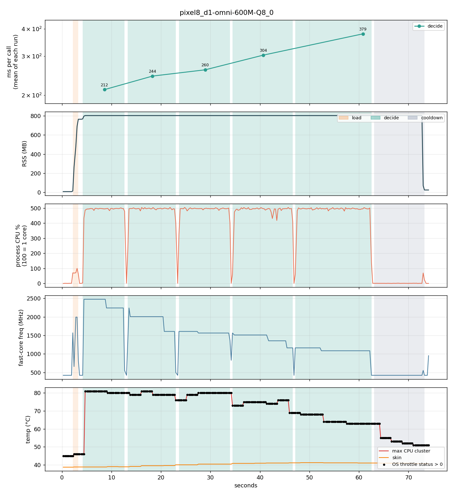
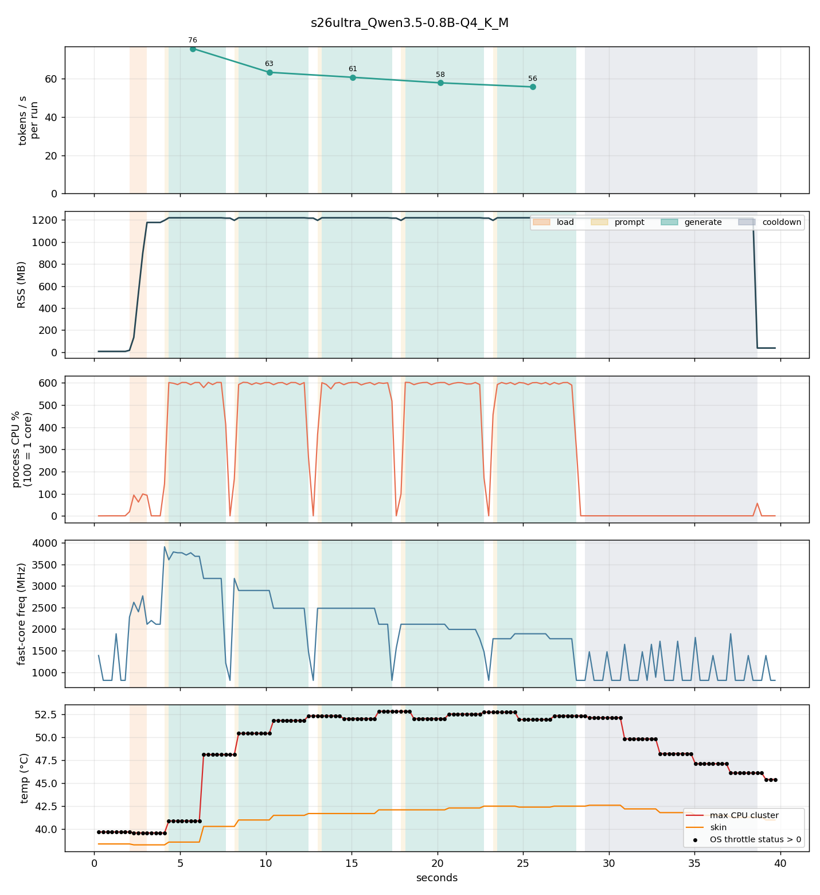

# Benchmarks

What a model costs on a real device while it is being used: speed, memory, processor use,
clock speed and heat, sampled over time. Produced by `kiln-bench` (`tools/kiln-bench`) and
`scripts/bench_plot.py`; rerun everything with `scripts/bench.sh`.

Every kind of model is measured the way an app uses it. `kiln-bench` reads the kind from the
model file:

| kind | one run is | speed is reported as |
|---|---|---|
| chat model | a ~65-token prompt and 256 generated tokens | tokens per second |
| decision model | 40 questions about a support message (yes / no, choice, score in turn) | milliseconds per question |
| embedding model | 150 notes of 15 to 40 tokens embedded as documents | milliseconds per note |
| embedding model with its projector | then 5 embeddings of each kind of media the projector takes: an image, and a 3-second audio clip (Jina's projector is image-only) | milliseconds per item |

Each series is 5 runs back to back with a 0.5 s gap. The series of one model follow each other
without a pause (text, then image, then audio), and the cooldown comes only after the last one,
so the media series always start on a device the text series has already warmed. Sampler at 250 ms:
process RSS, process CPU% (100 = one core), mean frequency of the fast cores, CPU cluster and
skin temperature (Android: `dumpsys thermalservice`, since `/sys/class/thermal` is not
readable by apps on Android 14+), and the OS thermal throttle status.

Dates: chat models on the Pixel 8, and everything for decision and embedding models, were run
on 2026-10-13 with kiln v0.3.0. The M4 Pro chat figures are from 2026-10-10 (v0.1.0); see the
M4 section for why. llama.cpp b11548 throughout.

## Why the same job runs 5 times

In the app, one prompt gives one answer. Nothing is repeated. The 5 repeats exist only in the
benchmark, to imitate a long chat session under controlled conditions.

A user chatting for a minute sends several messages back to back. Each one heats the phone a
little more, so message 5 runs on a hotter SoC than message 1 and comes out slower. To measure
that effect the bench could send 5 different prompts, but then a speed difference might come
from the prompts differing in length or difficulty. So it sends the *same* prompt 5 times:
now the only thing that changes between run 1 and run 5 is heat.

So "how fast is kiln on a Pixel 8 with Qwen3.5 0.8B?" has two honest answers: 37 tok/s for
the first message, about 26 tok/s a minute into the conversation. Quote both.

The same holds for the other kinds. On the Pixel 8 a question to a decision model averaged
0.21 s over the first 40, on a phone that was already slightly warm (38.7 °C skin, throttle
status 1). An app that classifies a whole inbox asks hundreds in a row, and by the fifth run
each one takes 0.38 s.

## How to read the tables

- **run**: one repetition of the job: reset the context, feed the ~65-token prompt, generate
  256 tokens. The bench does 5 runs back to back with a 0.5 s gap. Run 1 starts on a cool
  phone. Run 5 starts after 40 to 60 s of nonstop generation, on a hot phone. Nothing else
  changes between runs: same model, prompt, seed, code.
- **gen tok/s run 1 → 5**: generation speed measured in run 1, then in run 5. The gap between
  the two numbers is the cost of heat. Report the run-5 number if you want to be honest about
  what a chat session feels like.
- **fast-core MHz run 1 → 5**: average clock of the five fast cores while generating, run 1
  versus run 5. The SoC lowers the clock to hold the cluster at ~80 °C. Fewer MHz, fewer
  tok/s; the two columns move together.
- **CPU temp**: hottest CPU cluster reported by the thermal HAL, at bench start → maximum.
- **OS throttle**: Android's thermal status (0 none, 1 light, 2 moderate, 3 severe, up to 6).
  Driven by *skin* temperature, not cluster temperature; on the Pixel 8 status 1 starts at
  39 °C skin. "not within 20 s" means the run was too short to trigger it.
- **RSS after load / peak RSS**: resident memory of the process right after the model and
  context are created, and the maximum seen. Includes the mmap'd model file once touched.
- **process CPU%**: CPU time consumed per wall second, summed over threads. 100 = one core
  fully busy; 500 = five cores fully busy.
- **load**: wall time for `kiln_model_load` + `kiln_context_create`.

See [../GLOSSARY.md](../GLOSSARY.md) for the rest of the project's vocabulary.

## Pixel 8 (Tensor G3, CPU, 5 threads pinned to X3 + 4x A715)

### Chat models

| model | load | RSS after load | peak RSS | gen tok/s run 1 → 5 | fast-core MHz run 1 → 5 | CPU temp max | OS throttle |
|---|---|---|---|---|---|---|---|
| LFM2.5 350M Q4_K_M | 0.9 s | 507 MB | 514 MB | 111 → 98 | 2476 → 2476 | 91 °C | none in 15 s |
| Qwen3.5 0.8B Q4_K_M | 2.1 s | 1176 MB | 1218 MB | 37 → 26 | 2476 → 1607 | 83 °C | status 1 at 42 s |
| Gemma 3 270M Q8_0 | 1.2 s | 658 MB | 664 MB | 80 → 65 | 2205 → 2017 | 81 °C | status 1 from the start |

LFM2.5 and Qwen started on a phone at 34 to 35 °C skin temperature. Gemma was run later in the
session and started at 38.8 °C, already at throttle status 1, which is why its first run does
not begin at the full clock. At v0.1.0 (2026-10-10) the same table read 109 → 90, 38 → 31 and
80 → 71: the first runs agree, and how far the last run falls depends on how warm the phone
already is.

### Decision model

| model | load | peak RSS | ms per question, run 1 → 5 | questions per second | fast-core MHz run 1 → 5 |
|---|---|---|---|---|---|
| LFM2 d1-omni 600M Q8_0 | 1.2 s | 803 MB | 212 → 379 | 4.7 → 2.6 | 2306 → 1111 |

Each question is 79 tokens with its state. 200 questions in a row took 56 s. The phone was at
38.7 °C skin when this started (throttle status 1), and over the minute the OS stepped the
fast cores down to 1.1 GHz: the cluster cooled to 63 °C while each question got slower. It is
the skin temperature that the OS is protecting, not the chip.

### Embedding models

| model | input | load | RSS | ms per input, run 1 → 5 | fast-core MHz run 1 → 5 |
|---|---|---|---|---|---|
| nomic-embed-text v1.5 Q4_K_M | note (24 tok) | 0.5 s | 177 MB | 27 → 33 | 2475 → 1942 |
| jina v5 omni nano Q4_K_M | note (21 tok) | 1.0 s | 297 MB | 25 → 27 | 2476 → 1920 |
| | image (256 media tok) | +0.5 s | 672 MB | 4.6 s → 6.0 s | 1390 → 1080 |
| EmbeddingGemma 2 UD-Q4_K_XL | note (26 tok) | 1.5 s | 394 MB | 39 → 54 | 2476 → 1511 |
| | image (81 media tok) | +1.2 s | 1061 MB | 5.7 s → 6.0 s | 1180 → 1073 |
| | 3 s audio clip (78 media tok) | | | 3.1 s → 1.6 s | 995 → 1012 |

The projector row's load time and memory are on top of the text model: EmbeddingGemma 2's
encoders add 563 MB, Jina's vision encoder 207 MB.

Three things to take from this:

- **Text embedding is cheap and holds up.** 750 notes in a row cost 20 to 40 s, and the last
  ones are 10 to 40% slower than the first. A single query is 25 to 55 ms whatever the state
  of the phone.
- **The image and audio figures here are for a phone that is already warm.** In a session the
  media runs come after the 750 notes, so they start with the clock already cut to about
  1.1 GHz, and it stays there. A single image on a cool phone takes 2.8 s and a 3-second clip
  0.9 s (measured separately with `kiln-cli`); in the middle of a long indexing job the same
  image takes 5 to 6 s. Plan media indexing as slow background work.
- **Memory pressure costs more than heat.** With the 1 GB of EmbeddingGemma 2 plus projector
  loaded, Android had under 1 GB left for everything else and took pages of the model back
  (RSS fell from 1061 MB to 762 MB during the run). Calls that hit an evicted page reread it
  from storage: audio calls ranged from 1.1 s to 5.8 s inside one run. In an earlier run of the
  decision model another app claimed about 1 GB halfway through, half the model was evicted,
  and questions went from 0.22 s to 0.82 s with single ones at 2.4 s. A phone that is doing
  other things will do this to any model that takes a large share of its free memory.

### Speech models (v0.4.0, 2026-10-13)

`kiln-bench` writes down `tests/media/speech_train.wav` and `speech_recipe.wav` (3.1 and 3.2 s)
five times per burst, five bursts per clip; the figure is the mean call. The phone had been
running tests for two hours and started these at throttle status 1.

| model | first burst | later bursts | notes |
|---|---|---|---|
| Parakeet TDT 0.6B v3, q8_0 (whisper.cpp) | 0.28 s | 0.28 s for three bursts, then 0.8 to 1.5 s at 82 °C | encoder about 0.22 s, decoder 25 to 35 ms |
| Whisper base, q5_1 (whisper.cpp) | 3.5 s | 4 to 7.5 s | always encodes a 30-second window |
| Qwen3-ASR 0.6B, Q8_0 (llama.cpp) | 3.8 s (single call, `kiln-cli`) | not benchmarked | 2.5 s of it in the audio encoder |

These need the Android build with OpenMP (the default since 0.4.0): without it the decoders
took 1 to 13 s per clip with no two runs alike. Raw files: `pixel8_ggml-*.csv`.

### What the chat charts say (v0.1.0 run)

- **CPU: all five fast cores saturated the whole time.** Process CPU sits at 480 to 500%. The
  pinned threadpool is doing exactly what it should. Little cores stay idle.
- **The CPU cluster hits ~80 °C within one second of generation starting** and stays there. The
  SoC then holds temperature by stepping frequency down: 2.48 GHz at run 1, 1.69 GHz by run 5
  on Qwen. Token rate follows: **-18% for Qwen, -18% for LFM2.5, -11% for Gemma across 60
  seconds** of sustained generation. This is before the OS even declares throttling.
- **OS throttle status flips to 1 when skin temperature crosses 39 °C**, about 30 to 36 seconds
  into sustained generation. Status 1 is mild; a long chat session would walk up the ladder
  (43 °C, 45 °C, 46.5 °C ...) and lose more.
- **Memory is flat and predictable.** RSS = model file (mmap, fully touched) + KV cache for
  n_ctx 2048 + ggml compute buffers. Qwen3.5 0.8B costs 1.2 GB resident, more than 2x its file
  size, because its hybrid architecture has large state buffers. RSS drops to tens of MB after
  free: no leaks across 5 runs.
- **Prompt eval is cheap and stable**: 120 to 490 ms for 65 tokens; not affected by thermals
  much because it is short.

### Implications for the library

1. Peak tok/s from a single short run is a lie on phones. The honest number is the run-5
   figure, and the stats API already reports per-call tok/s so an app can watch it decay.
2. 5 threads pegged at 100% is the fastest way to hit the thermal wall. Worth testing whether
   4 threads gives a higher *sustained* rate at lower temperature. On the roadmap.
3. "Available RAM" on this 8 GB phone bottomed at 1.67 GB with Qwen loaded. A 2B model at Q4
   (1.5 to 2.5 GB resident) would work but would start evicting other apps.

## Galaxy S26 Ultra (Snapdragon 8 Elite Gen 5, CPU, 6 threads pinned to cores 2 to 7)

2026-10-12, kiln v0.3.0 plus the core-selection fix this phone led to. The chip has no little
cores: two at 4.74 GHz and six at 3.63 GHz. kiln v0.3.0 used only the two; it now uses six.
The whole story, the core sweep and a GPU trial are in
[../devices/galaxy-s26-ultra.md](../devices/galaxy-s26-ultra.md). Files: `s26ultra_*` is the
new default, `s26ultra-2t_*` the v0.3.0 default, `s26ultra-8t_*` all eight cores (chat models).

Every series started on a warm phone (38.5 °C skin, throttle status 1), so compare the first
runs here with the Pixel 8's warm figures, not its cold ones.

| model | load | peak RSS | speed run 1 → 5 | fast-core MHz run 1 → 5 |
|---|---|---|---|---|
| LFM2.5 350M Q4_K_M | 0.3 s | 513 MB | 224 → 194 tok/s | 3652 → 2894 |
| Qwen3.5 0.8B Q4_K_M | 1.0 s | 1218 MB | 76 → 56 tok/s | 3511 → 1827 |
| Gemma 3 270M Q8_0 | 0.5 s | 665 MB | 173 → 146 tok/s | 3694 → 2934 |
| LFM2 d1-omni 600M Q8_0 | 0.5 s | 802 MB | 77 → 122 ms per question | 3546 → 2160 |
| nomic-embed-text v1.5 | 0.2 s | 177 MB | 10 → 13 ms per note | 3741 → 2726 |
| jina v5 omni nano | 0.4 s | 297 MB | 9 → 11 ms per note | 3758 → 2987 |
| | +0.2 s | 677 MB | image: 1.5 → 2.1 s | 2550 → 1766 |
| EmbeddingGemma 2 | 0.5 s | 393 MB | 17 → 24 ms per note | 3738 → 2587 |
| | +0.7 s | 1074 MB | image: 1.5 → 2.2 s | 2269 → 1570 |
| | | | 3 s audio clip: 0.55 s (first run 1.4 s) | 1605 → 1541 |

Against the Pixel 8 in the same warm state, this phone is about twice as fast for chat (Qwen3.5
56 vs 26 tok/s in the fifth run), three times as fast for decisions and text embedding, and three
times as fast for images. It also never ran short of memory: at least 3 GB stayed available with
the largest model loaded, where the Pixel 8 dropped under 1 GB and stalled.

The same throttling pattern is there, just gentler: the OS steps the clock down as the skin
warms from 38.5 to about 42 °C, and the fifth run is 15 to 35% slower than the first.

## M4 Pro (Metal)

| model | load | peak RSS | gen tok/s (5 runs) | process CPU |
|---|---|---|---|---|
| LFM2.5 350M Q4_K_M | 0.2 s | 365 MB | 210 to 362 | ~26% |
| Qwen3.5 0.8B Q4_K_M | 0.5 s | 761 MB | 139 to 147 | ~25% |
| Gemma 3 270M Q8_0 | 0.4 s | 468 MB | 118 to 166 | ~25% |

CPU stays at a quarter of one core: the GPU does the work and the sampler cannot see it
(no GPU counters yet). Run-to-run variance on tiny models is dispatch overhead, not thermals.
RSS decreases over time as macOS reclaims clean mmap pages.

The chat figures above are from v0.1.0. On 2026-10-13 the machine was busy (Spotlight indexing,
a browser-based app drawing on the GPU) and Qwen3.5 read 92 to 110 tok/s. Alternating the
v0.1.0 and v0.3.0 builds in that state gave 98 to 173 tok/s for the old one and 102 to 177 for
the new one, so the difference is the machine, not the code, and the quiet-machine numbers are
kept. Benchmark Metal on a Mac that is doing nothing else.

Decision and embedding models, 2026-10-13, on the same busy machine. Treat these as rough: the
load that made the chat figures swing affects these calls too, and they have not been repeated
on an idle Mac.

| model | input | peak RSS | ms per input, run 1 → 5 |
|---|---|---|---|
| LFM2 d1-omni 600M Q8_0 | question (79 tok) | 543 MB | 20 → 20 |
| nomic-embed-text v1.5 Q4_K_M | note | 189 MB | 6 → 6 |
| jina v5 omni nano Q4_K_M | note | 322 MB | 8 → 9 |
| | image | 706 MB | 87 → 89 |
| EmbeddingGemma 2 UD-Q4_K_XL | note | 415 MB | 12 → 17 |
| | image | 1065 MB | 98 → 95 |
| | 3 s audio clip | | 50 → 55 |

Nothing slows down over the five runs: there is no thermal limit to hit at this load.

## Files

- `<device>_<model>.csv`: raw samples. Columns: `t_ms,run,phase,rss_mb,cpu_pct,freq_mhz,temp_c,skin_c,throttle,mem_avail_mb,tokens`.
  `phase` is `load`, `prompt`, `generate`, `decide`, `embed` (text), `encode` (image or audio),
  `cooldown` or `idle`. For decision and embedding models `tokens` counts calls in the run.
- `<device>_<model>.runs.csv`: one line per run. Columns:
  `series,run,unit,count,total_ms,mean_ms,min_ms,max_ms,per_s,rss_mb,temp_c,tokens_per_call,prompt_tok,prompt_ms`,
  and from v0.3.1 `sample_run`, the `run` value the same run has in the samples file (`run`
  itself counts inside the series). In files written by v0.3.0 the chat rows have 0.00 for
  `min_ms` and `max_ms`; single tokens are not timed, and newer files leave those two empty.
  `series` is `chat`, `decide`, `embed-text` or `embed-<media file>`; `unit` is `tok` or `call`.
  The M4 Pro chat files have none: they predate it.
- `<device>_<model>.png`: chart. The top panel is the speed of each run, at the time it ran.
- `summary.md`: table regenerated by `bench_plot.py`.
