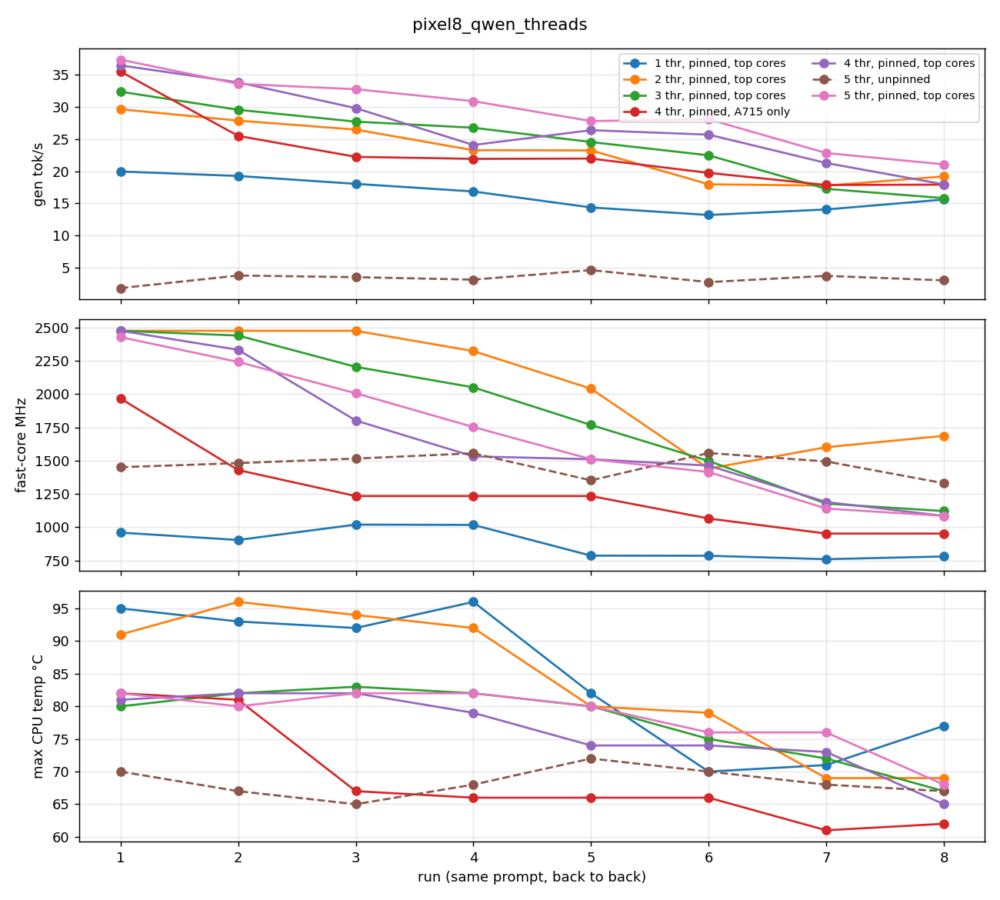

# Thread sweep: Pixel 8, Qwen3.5 0.8B Q4_K_M

Same job (65-token prompt, 256 generated tokens) run 8 times back to back per configuration,
60 s idle between configurations. 2026-10-10. Raw CSVs and the chart are in this folder;
regenerate with `scripts/bench_compare.py docs/bench/threads 'pixel8_qwen_t*.csv' <out.png>`.

Configurations: N threads pinned to the N highest-numbered fast cores (X3 first, then the
A715s), one run with 4 threads pinned to the four A715s only (`KILN_CPU_MASK=f0`), and one
with 5 threads and no affinity at all (`KILN_NO_AFFINITY=1`).

| config | run 1 tok/s | run 8 tok/s | mean tok/s | drop | max CPU temp |
|---|---|---|---|---|---|
| 1 thr (X3) | 20.0 | 15.6 | 16.4 | 22% | 96 °C |
| 2 thr (X3 + 1 A715) | 29.6 | 19.2 | 23.2 | 35% | 96 °C |
| 3 thr | 32.3 | 15.8 | 24.5 | 51% | 83 °C |
| 4 thr, A715 only | 35.4 | 17.9 | 22.8 | 49% | 82 °C (A715 cluster 66 °C after run 2) |
| 4 thr, X3 + 3 A715 | 36.4 | 18.0 | 26.9 | 51% | 82 °C |
| **5 thr, X3 + 4 A715** | **37.3** | **21.1** | **29.3** | 44% | 82 °C |
| 5 thr, unpinned | 1.9 | 3.1 | 3.3 | – | 72 °C |

"MHz" in the chart is the mean over the five fast cores, so for 1 to 4 threads it is dragged
down by idle cores; compare shapes, not absolute values, for those rows.

## Findings

1. **5 pinned threads win everywhere**: cold, hot, and on average. The hypothesis that fewer
   threads would run cooler and therefore faster in steady state is false on this SoC. Decode
   is bandwidth bound; five cores pull more bandwidth, and the thermal governor clamps the
   clock to about the same floor (~1.1 GHz by run 8) regardless of thread count.
2. **Fewer threads run hotter, not cooler.** 1 and 2 threads push the X3 to 96 °C because a
   single core at full clock is the worst case for a hotspot. Spreading the same work over five
   cores caps at 82 °C.
3. **Unpinned threads on a warm phone are catastrophic: 2 to 5 tok/s.** With the OS thermal
   status at 1 (skin 39 °C, which a phone reaches after a minute of chat), Android's scheduler
   parks the workers on the A510 little cores and ggml's barrier waits for them. Earlier the
   same configuration on a cold phone gave 22 to 32 tok/s. So an unpinned library looks fine
   in a demo and collapses in a real session. This is the single biggest reason "runs on
   phones" claims fail, and it is the default behaviour of every llama.cpp wrapper that does
   not set affinity.
4. **X3 in or out barely matters at 4 threads** (36.4 vs 35.4 cold, 18.0 vs 17.9 hot). The
   A715-only set keeps its own cluster 15 °C cooler, which may matter for battery and skin
   temperature over a long session, but it did not translate into more tokens here.
5. **Sustained throughput is roughly half of cold throughput** after 70 s regardless of
   configuration (44 to 51% drop). Any phone benchmark shorter than a minute reports the
   wrong number.

## What this means for the policy

- Default stays: all cores outside the little tier, pinned. Confirmed, not assumed, on one SoC.
- Pinning is not optional. It is the difference between 21 and 3 tok/s on a warm phone.
- Thread count beyond the fast set was not tested here (adding little cores to a pinned set
  would reintroduce the barrier problem by construction).
- Other SoCs will differ in whether the prime core helps, whether a four-tier layout should
  mix tiers, and where the bandwidth knee is. That is why the auto-tune in
  [docs/CPU.md §6](../../CPU.md) is the plan rather than a table.
