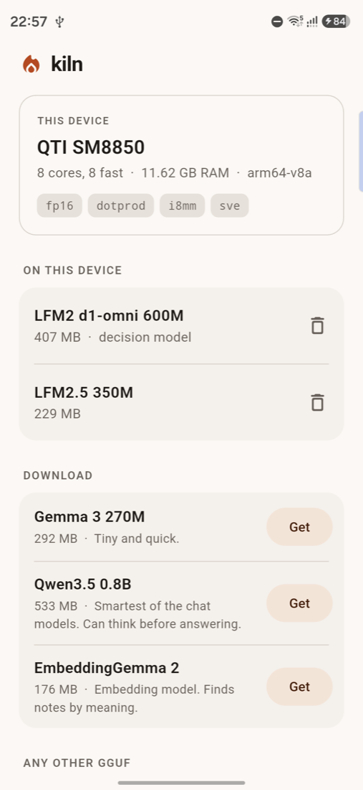
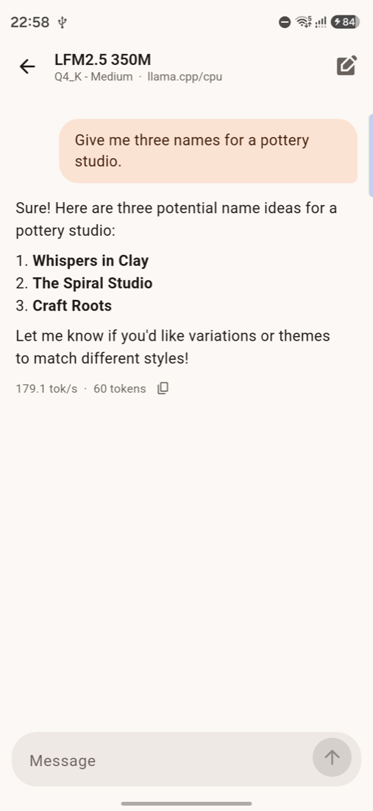

# Galaxy S26 Ultra (SM-S948B)

Snapdragon 8 Elite Gen 5. The first Snapdragon kiln was run on, on 2026-10-12, with kiln v0.3.0
plus the changes this phone led to, which were released as v0.3.1. It was a borrowed phone: everything here was collected in one
session so that later work does not need it.

## Hardware, as the system reports it

| | |
|---|---|
| chip | Qualcomm SM8850 (`ro.soc.model`), platform `canoe` |
| Android | 17 (SDK 37), vendor image 16, security patch 2026-09-05, 4 KB pages |
| RAM | 11.35 GB total, about 4 GB available with the owner's apps running; 12 GB of swap |
| cores 0 to 5 | top clock 3.63 GHz, `cpu_capacity` 741, share one L2 cache |
| cores 6 and 7 | top clock 4.74 GHz, `cpu_capacity` 1024, share one L2 cache |
| core design | all eight are the same Qualcomm design (implementer 0x51, part 0x002): no little cores |
| frequency governor | `walt` |
| CPU features | fp16, dotprod, i8mm, bf16, SVE, SVE2, SME (kiln builds for dotprod + fp16 only) |
| GPU | Adreno 840. Vulkan 1.4 (`vulkan.adreno.so`), OpenCL 3.0 (`/vendor/lib64/libOpenCL.so`) |
| other | Qualcomm SNPE libraries are present (`libSNPE.so`, HTP stub v81) |

`cpu_capacity` is the kernel's own rating of each core's compute power, with the strongest core
at 1024. A little core on a big.LITTLE chip is around a quarter of that; here the "slow" cores
are at 72%.

## What kiln chose, before and after

| | cores it called fast | threads | pinned to |
|---|---|---|---|
| v0.3.0 | 2 (mask `0xc0`) | 2 | cores 6, 7 |
| v0.3.1 | 8 (mask `0xff`) | 6 | cores 2 to 7 |

kiln's rule was "group cores by top clock and drop the slowest group", written for chips with
little cores. Here it dropped six strong cores. The rule now keeps the slowest group when its
`cpu_capacity` is at least half of the strongest core's, and where every core is fast it leaves
two free for the rest of the system. Both rules are in `src/probe/fast_cores.h` with unit tests
that use this phone's values and the Pixel 8's. For comparison, the Pixel 8 reports 182 for its
little cores, 725 for the middle ones and 1024 for the big one; it was re-run after the change
and keeps its 5 threads.

## Which cores to use: the sweep

A short prompt and 200 generated tokens, twice per setting (the table shows the mean), `kiln-cli`.
`KILN_CPU_MASK` picks the cores. The phone warmed up during the sweep, so later rows are at a
slight disadvantage.

| cores | Qwen3.5 0.8B prompt / generate tok/s | LFM2.5 350M prompt / generate tok/s |
|---|---|---|
| 2 prime (`c0`, the old default) | 136 / 45 | 266 / 112 |
| 2 prime + 2 (`f0`) | 159 / 52 | 352 / 135 |
| **2 prime + 4 (`fc`, the new default)** | 187 / 53 | 444 / 145 |
| all 8 (`ff`) | 201 / 52 | 457 / 135 |
| the 6 slower cores only (`3f`) | 141 / 47 | 374 / 117 |
| 4 of the slower cores (`0f`) | 114 / 37 | 284 / 107 |
| 8 threads, not pinned | 3 / 24 | 9 / 40 |
| 4 threads, not pinned | 11 / 40 | 302 / 110 |

- Generating text gains little beyond four cores: it is limited by how fast memory can be read,
  and the two prime cores already do most of it. Reading the prompt keeps scaling with cores.
- **Not pinning is ruinous**, as on the Pixel 8: with 8 free-running threads Qwen read its
  prompt at 3 tokens per second, 60 times slower than pinned.
- Under sustained load six beat eight on all three chat models (fifth run: LFM2.5 194 vs 164
  tok/s, Qwen3.5 56 vs 49, Gemma 3 146 vs 133). Eight threads heat the chip faster and leave no
  core for anything else.

## Speed

Five runs back to back per series; first run → fifth run. The phone was already at 38.5 °C skin
temperature and throttle status 1 when each model started (it had been in use and benchmarked
all evening), so these are warm-phone numbers. Full charts in [../bench](../bench/README.md).

| model | 2 threads (v0.3.0 default) | 6 threads (new default) |
|---|---|---|
| LFM2.5 350M | 208 → 164 tok/s | 224 → 194 tok/s |
| Qwen3.5 0.8B | 71 → 45 tok/s | 76 → 56 tok/s |
| Gemma 3 270M | 185 → 152 tok/s | 173 → 146 tok/s |
| LFM2 d1-omni, per question | 130 → 201 ms | 77 → 122 ms |
| nomic-embed-text, per note | 17 → 24 ms | 10 → 13 ms |
| EmbeddingGemma 2, per note | 26 → 37 ms | 17 → 24 ms |
| EmbeddingGemma 2, small image | 2.5 → 3.6 s | 1.5 → 2.2 s |
| EmbeddingGemma 2, 3 s audio clip | 0.80 → 0.80 s | 0.55 s (first run 1.4 s) |

Six threads help most where the work is reading input rather than generating: questions to
the decision model and embeddings take 35 to 45% less time. Chat with LFM2.5 and Qwen3.5 is
18 to 24% faster by the fifth run. Gemma 3 270M is the one model that was slightly faster on
two threads (4%).

Through the Flutter plugin on the same phone, three runs of 128 tokens: LFM2.5 207 to 214 tok/s,
Qwen3.5 59 to 72, Gemma 3 151 to 159. In the example app a reply streamed at 179 tok/s.

Memory was never under pressure: at least 3 GB stayed available with the 1 GB EmbeddingGemma 2
plus projector loaded, and no model pages were evicted. Compare the Pixel 8, where the same
load left under 1 GB and calls stalled.

## Heat

The thermal service reports the chip ("AP") at 40 °C idle and 51 to 53 °C under load, skin at
38.5 → 41 to 43 °C, and throttle status 1 rising to 2 during the longer runs. The clock of the
fast cores falls from about 3.6 GHz to 1.8 to 2.9 GHz over five runs, less steeply than on the
Pixel 8. One raw thermal zone reads a constant 105 °C, which is why `kiln-bench` now takes its
temperatures from the thermal service first.

## Tests

| what | result |
|---|---|
| `kiln-tests` (C suite), v0.3.0 default | 319 passed |
| `kiln-tests` with the core-selection fix | 319 passed |
| Flutter integration test with `KILN_SPEED` and `KILN_MEDIA` | 26 passed |
| example app: library, load, chat | works; the device card shows "QTI SM8850, 8 cores, 8 fast" |

The suite and the benchmarks ran with the rule in its first form, inside the probe. The final
form (pure functions in `fast_cores.h`, with 15 unit checks) was then run on the phone as well:
the probe gave the same result (`fast: 8, mask: 0xff`) and the unit checks passed there.

## GPU: OpenCL on the Adreno 840

A trial, not a supported build. `-DKILN_GPU=ON -DKILN_ANDROID_GPU=opencl` compiles and runs.

| model | GPU prompt / generate tok/s | CPU (6 threads) prompt / generate tok/s |
|---|---|---|
| LFM2.5 350M (17 layers on GPU) | 24 / 120 to 152 | 514 / 160 |
| Qwen3.5 0.8B (25 layers) | 16 / 41 | 206 / 54 |
| Gemma 3 270M (19 layers) | 13 / 61 | 1430 / 129 |

- For models this small the CPU wins everywhere. Generation on the GPU reaches 75 to 95% of the
  CPU for LFM2.5 and Qwen3.5 and about half for Gemma. Reading the prompt is 10 to 100 times
  slower on the GPU; part of that is start-up work repeated on every process launch.
- The picture may differ for models of 2B parameters and up, where a GPU usually starts to
  pay off. None was tried.
- The full C suite passes on the OpenCL build (319 checks), with models on the CPU, which is
  what the default `auto` backend picks there.
- One unexplained result: on the OpenCL build the audio encoder took 14 s for a 3-second clip
  instead of 0.5 s. Not investigated.

How to build it again (needs a libOpenCL.so to link against, copied from a device):

```bash
git clone --depth 1 https://github.com/KhronosGroup/OpenCL-Headers.git
adb pull /vendor/lib64/libOpenCL.so
cmake --preset android-arm64 -B build/android-arm64-opencl -DANDROID_STL=c++_static \
  -DKILN_GPU=ON -DKILN_ANDROID_GPU=opencl \
  -DOpenCL_INCLUDE_DIR=$PWD/OpenCL-Headers -DOpenCL_LIBRARY=$PWD/libOpenCL.so \
  -DCMAKE_SHARED_LINKER_FLAGS=-Wl,--allow-shlib-undefined -DCMAKE_EXE_LINKER_FLAGS=-Wl,--allow-shlib-undefined
cmake --build build/android-arm64-opencl -j
# on the device, next to the binaries:  ln -s /vendor/lib64/libOpenCL.so libOpenCL.so
#                                       LD_LIBRARY_PATH=. ./kiln-cli --gpu -m model.gguf ...
```

Two traps, both hit:

- **Do not put `/vendor/lib64` on `LD_LIBRARY_PATH`.** The vendor image is one Android version
  behind the system, and the loader then takes the vendor's older C++ runtime for system
  libraries: `cannot locate symbol ... referenced by /system/lib64/liblog.so`. Link only
  `libOpenCL.so` into the working folder.
- **Use the static C++ runtime** (`c++_static`) for this build. With `libc++_shared.so` shipped
  next to the binary the same symbol clash appears.

An app would also need `<uses-native-library android:name="libOpenCL.so" android:required="false"/>`
in its manifest to be allowed to load the vendor library. Not tried.

Vulkan was not built: llama.cpp's Vulkan backend needs SPIRV-Headers and the C++ Vulkan headers,
which the NDK does not ship.

## Not done on this phone

- A model of 2B parameters or more, on CPU or GPU.
- The NPU (Qualcomm QNN / SNPE).
- A cold-phone run: every series started warm.
- i8mm, SVE2 or SME code paths (kiln builds for dotprod + fp16).
- Backgrounding the app mid-reply and rotating the screen.

 
